# GekayRealEstate

## Real-Estate Management System

**Project documentation**  
Prepared from `sample_doc.pdf`, the project source tree, and the diagrams in
[`doc/img/`](./img/index.png).

---

## Contents

- [1. Introduction](#1-introduction)
- [2. System Study](#2-system-study)
- [3. Requirements and Analysis](#3-requirements-and-analysis)
- [4. Technology and Project Architecture](#4-technology-and-project-architecture)
- [5. System Design](#5-system-design)
- [6. Implementation](#6-implementation)
- [7. Testing](#7-testing)
- [8. User Interface and System Results](#8-user-interface-and-system-results)
- [9. Deployment and Maintenance](#9-deployment-and-maintenance)
- [10. Conclusion and Future Scope](#10-conclusion-and-future-scope)
- [Figures and project diagram index](#figures-and-project-diagram-index)
- [References](#references)

---

# 1. Introduction

## 1.1 Project background

GekayRealEstate is a web-based real-estate management system developed with
Python and Django. Visitors can browse property listings, inspect property
information, learn about realtors, and contact a realtor about a property.
Registered users can log in and review the inquiries associated with their
accounts.

Property information is stored in structured database records rather than only
in paper files, spreadsheets, or scattered messages. A listing includes
location, pricing, measurements, description, publication information, and
property photographs. Each listing is associated with a realtor.

## 1.2 Problem statement

Traditional property promotion makes it difficult to search available
properties quickly and maintain consistent information. Buyers may need to
request the same details repeatedly, while property managers may struggle to
track inquiries, realtor information, and listing status.

The project addresses these problems through a central application that
provides:

- searchable and paginated property listings;
- property detail pages and image galleries;
- realtor information;
- user registration and authentication;
- contact inquiries connected to listings;
- inquiry history in a protected dashboard; and
- an administration interface for managing records.

## 1.3 Project objectives

1. Provide a clear home page for discovering featured properties.
2. Display property listings with photographs and important details.
3. Support search by keyword, city, state, bedrooms, and price.
4. Provide a complete detail page for each property.
5. Maintain realtor records and display realtor information.
6. Provide registration, login, and logout functionality.
7. Allow authenticated users to view their submitted inquiries.
8. Record inquiries and notify the responsible office.
9. Provide Django administration for application data.
10. Keep the project maintainable through separate Django applications.

## 1.4 Scope

### Included

- Public home and about pages.
- Featured listings.
- Paginated listing catalogue.
- Listing detail pages and photographs.
- Property search and filtering.
- Realtor profiles.
- Registration, login, logout, and dashboard pages.
- Authenticated contact inquiries.
- Duplicate inquiry prevention for the same user and listing.
- Email notification after an inquiry.
- Django admin support.
- SQLite storage for local development.
- Static files and uploaded media.

### Not included in the current version

- Online payments.
- Property reservations or booking workflow.
- Real-time chat.
- Map or geospatial search.
- Advanced role management.
- Dedicated appointment scheduling.

## 1.5 Intended users

| User | Main activities |
|---|---|
| Visitor | Browse, search, compare informally, and read property information |
| Registered user | Submit inquiries and review personal inquiry history |
| Realtor | Have property and contact information represented in the system |
| Administrator | Maintain listings, realtors, users, and inquiries |
| Developer or student | Study a Django-based database web application |

## 1.6 Benefits

The application makes property information easier to discover and maintain.
Search and pagination reduce browsing effort, while database records preserve
listing and inquiry history. Administrators receive a central place for data
maintenance instead of relying on disconnected files and messages.

---

# 2. System Study

## 2.1 Existing real-estate listing process

In the existing manual or partially digital process, property details may be
kept in spreadsheets, paper files, social-media posts, and separate
communication channels. Information about photographs, prices, locations, and
contacts may not be presented consistently.

## 2.2 Existing-process limitations

- Slow property discovery.
- Inconsistent or outdated information.
- Difficulty comparing multiple properties.
- Repeated responses to common questions.
- Poor inquiry tracking.
- Limited historical records.
- Difficulty maintaining realtor and listing relationships.

## 2.3 Proposed GekayRealEstate system

The proposed system stores realtors, listings, users, and contact inquiries in
a Django-managed relational database. Public users can browse published
listings. A listing detail page displays its images, specifications,
description, location, and realtor. An authenticated user can submit an
inquiry and later review it from the dashboard.

The application is divided into focused modules:

| Module | Responsibility |
|---|---|
| `pages` | Home and about pages |
| `listings` | Listing display, detail pages, pagination, and search |
| `realtors` | Realtor records and administration |
| `accounts` | Registration, authentication, and dashboard |
| `contacts` | Property inquiries and email notifications |

## 2.4 Proposed-system advantages

The proposed system provides a single source of property information, faster
search, reusable templates, structured records, and Django administration. The
separation between applications, models, URLs, views, and templates also makes
the system easier to extend.

## 2.5 Feasibility

### Technical feasibility

Python, Django, SQLite, HTML, CSS, and JavaScript provide the required
capabilities for a database-driven web application. Django supplies routing,
templates, authentication, forms support, database access, middleware, and
administration.

### Operational feasibility

Visitors can browse properties without an account. Account-only functions are
protected by authentication, and administrators can use the familiar Django
admin interface to maintain records.

### Economic feasibility

The system uses open-source software and can run locally with SQLite. Hosting,
database, email delivery, and media storage can be upgraded independently for
a larger deployment.

### Figure 2.1 — Existing and proposed process

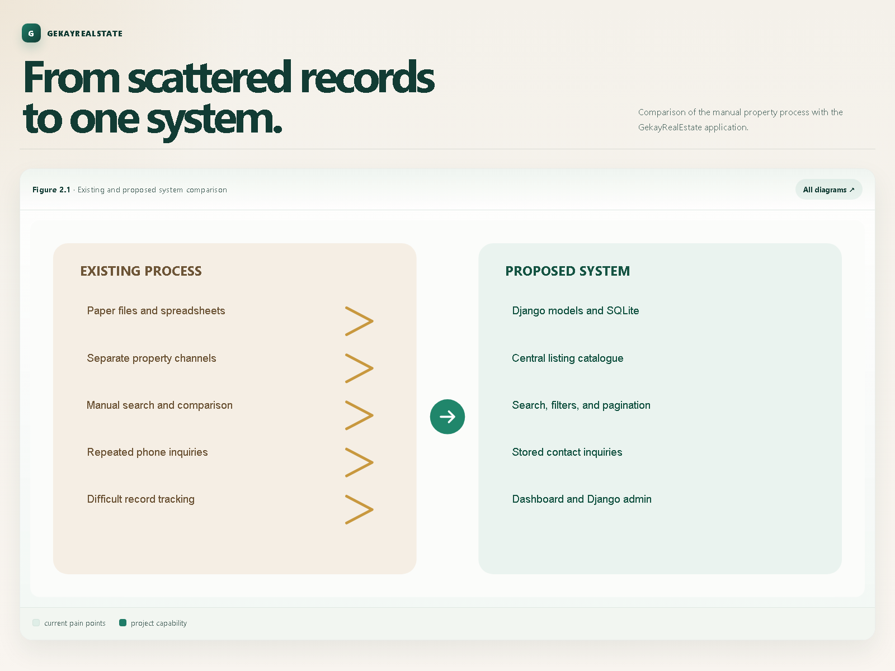

The figure connects the manual process—paper records, separate channels,
manual comparison, repeated calls, and difficult tracking—to the proposed
centralized Django system.

---

# 3. Requirements and Analysis

## 3.1 Functional requirements

| ID | Requirement |
|---|---|
| FR-01 | Display a home page with featured published listings |
| FR-02 | Store and manage property listing records |
| FR-03 | Search by keyword, city, state, bedrooms, and maximum price |
| FR-04 | Display a property detail page and gallery |
| FR-05 | Display realtor profile and contact information |
| FR-06 | Register, authenticate, and log out users |
| FR-07 | Display a protected inquiry dashboard |
| FR-08 | Submit and store inquiries for a selected listing |
| FR-09 | Prevent duplicate inquiries by the same logged-in user |
| FR-10 | Send an email notification after a valid inquiry |
| FR-11 | Provide Django admin for authorised data maintenance |

### Home page and featured listings

The home page displays a limited selection of recent published properties and
provides search choices for price, bedrooms, and state.

### Listing management

A listing stores title, realtor, address, city, state, postal code, description,
price, bedrooms, bathrooms, garage, floor area, lot size, publication status,
listing date, and photographs.

### Search and filtering

The search view accepts optional parameters. Keyword matching uses the
description, city and state use case-insensitive exact matching, and bedrooms
and price act as maximum filters. Results are ordered by listing date.

### Details and realtor information

The detail view displays a selected listing, its photographs and related
realtor. Realtor records include name, photograph, description, phone, email,
MVP status, and hire date.

### Registration, login, and dashboard

Registration validates matching passwords and duplicate username or email
values. The dashboard is protected by authentication and displays the current
user's inquiries, ordered by contact date.

### Contact and email notification

An inquiry contains listing information, visitor details, phone, message,
contact date, and user association. After a successful save, Django sends an
email to the configured office address. During local development, email can be
written to the console when SMTP credentials are absent.

## 3.2 Non-functional requirements

- **Usable:** clear navigation for first-time visitors.
- **Maintainable:** responsibilities separated by application.
- **Responsive:** usable on desktop and mobile layouts.
- **Reliable:** listing and inquiry records persist correctly.
- **Secure:** authentication and Django middleware protect account actions.
- **Extensible:** future booking, payment, and role features can be added.
- **Configurable:** secrets, hosts, and email credentials come from environment
  configuration.

## 3.3 Roles and permissions

| Role | Permissions |
|---|---|
| Visitor | View public pages, listings, realtor details, and search results |
| Registered user | Authenticate, submit inquiries, and view personal dashboard |
| Administrator | Manage users and application records through Django admin |

## 3.4 Software requirements

- Python 3.14
- Django 5.2
- SQLite for local development
- Pillow
- python-dotenv
- Gunicorn
- Whitenoise
- autopep8
- isort
- pylint

## 3.5 Hardware requirements

A development machine should have a modern processor, at least 4 GB RAM,
sufficient storage for the virtual environment and uploaded images, and network
access for dependency installation. End users need a browser and network
connection.

## 3.6 Use-case analysis

### Figure 3.1 — Use-case diagram

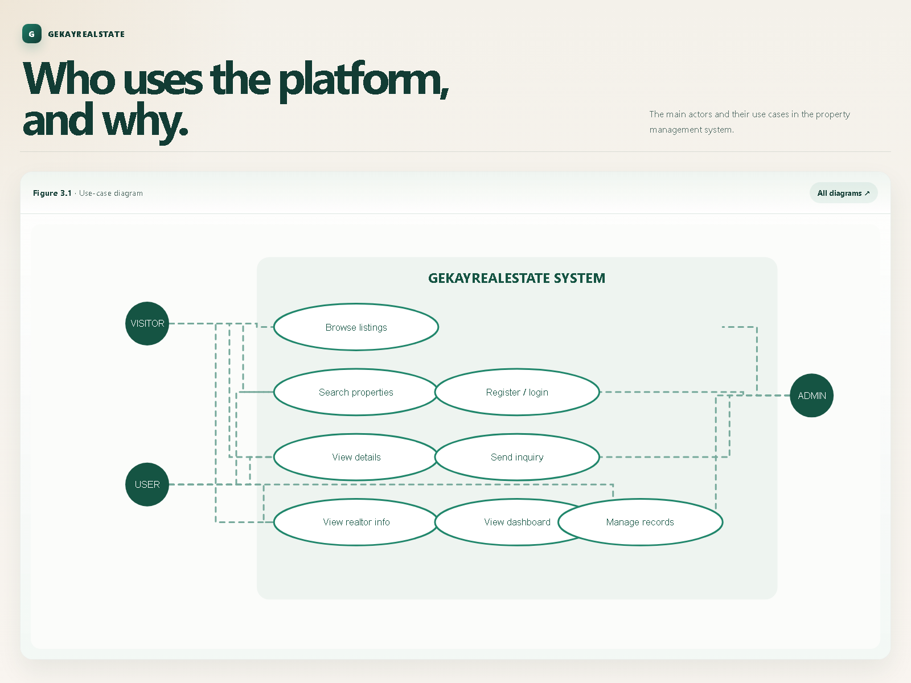

The visitor uses browsing, search, detail, and realtor-information functions.
The registered user adds registration, login, inquiry, dashboard, and logout
functions. The administrator manages application records.

## 3.7 Data-flow analysis

### Figure 3.2 — Data-flow diagram

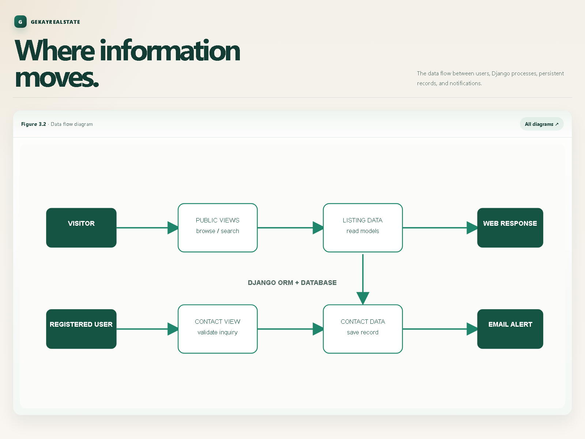

Property data flows from administrators into listing and realtor records.
Visitors read published data through Django views and templates. Authenticated
contact submissions are validated, saved as `Contact` records, and used to
send email alerts. The dashboard reads contact records associated with the
current user.

---

# 4. Technology and Project Architecture

## 4.1 Technology stack

| Technology | Use |
|---|---|
| Python | Configuration, models, views, routing, tests, and utilities |
| Django | Web framework, ORM, authentication, middleware, templates, and admin |
| SQLite | Local relational database |
| HTML templates | Shared and page-specific rendering |
| Bootstrap | Responsive layout and common controls |
| CSS | Project visual styling |
| JavaScript | Frontend interaction and image presentation |
| Pillow | Uploaded realtor and listing image handling |
| python-dotenv | Environment configuration |
| Gunicorn | Production WSGI server |
| Whitenoise | Static-file serving support |

## 4.2 Project directory structure

```text
GekayRealEstate/
├── accounts/       # authentication, dashboard, tests, URLs
├── contacts/       # inquiry model, views, URLs, migrations
├── djangofirst/    # settings, root URLs, WSGI configuration
├── listings/       # listing model, search views, URLs, migrations
├── pages/          # home and about pages
├── realtors/       # realtor model, views, migrations
├── templates/      # shared and application templates
├── djangofirst/
│   └── static/     # CSS, JavaScript, images, and fonts
└── doc/            # project documentation and diagrams
```

## 4.3 Django MVT architecture

### Figure 4.1 — Django MVT

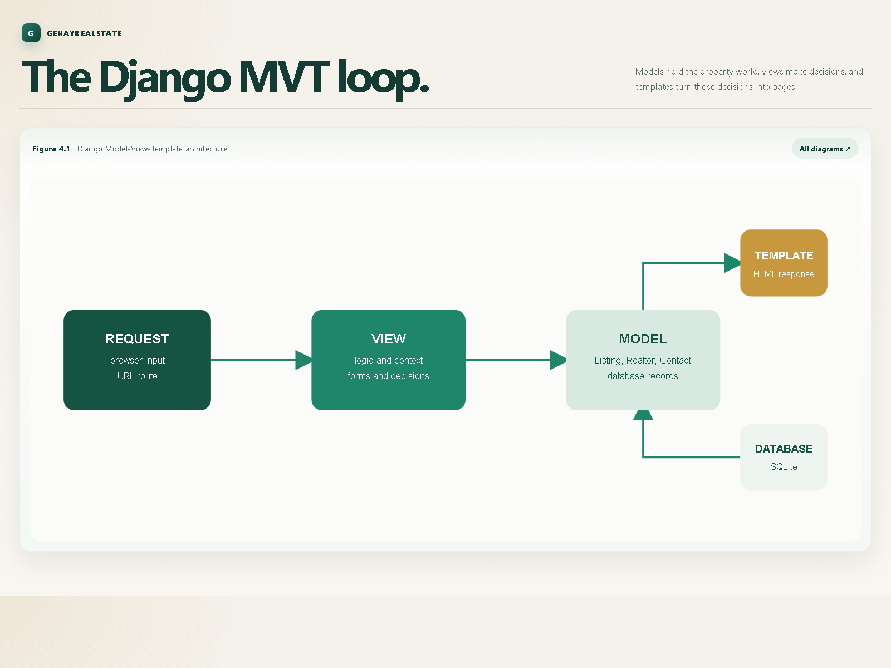

The request reaches Django URL configuration, which delegates to a view. The
view queries models through the ORM, prepares context, and renders a template.
The response returns HTML to the browser. The database persists users,
listings, realtors, and inquiries.

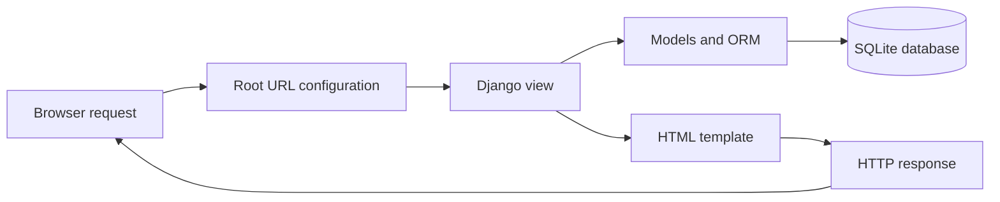

## 4.4 URL routing architecture

### Figure 5.3 — URL routing

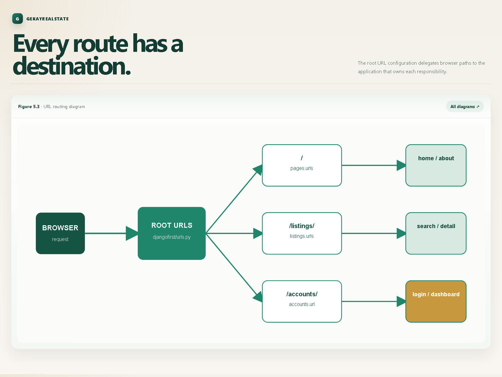

The root configuration delegates:

| Path | Application or destination |
|---|---|
| `/` | `pages` |
| `/listings/` | `listings` |
| `/accounts/` | `accounts` |
| `/contacts/` | `contacts` |
| `/admin/` | Django administration |

Media files are served from the configured media location during development.

## 4.5 Project architecture flow

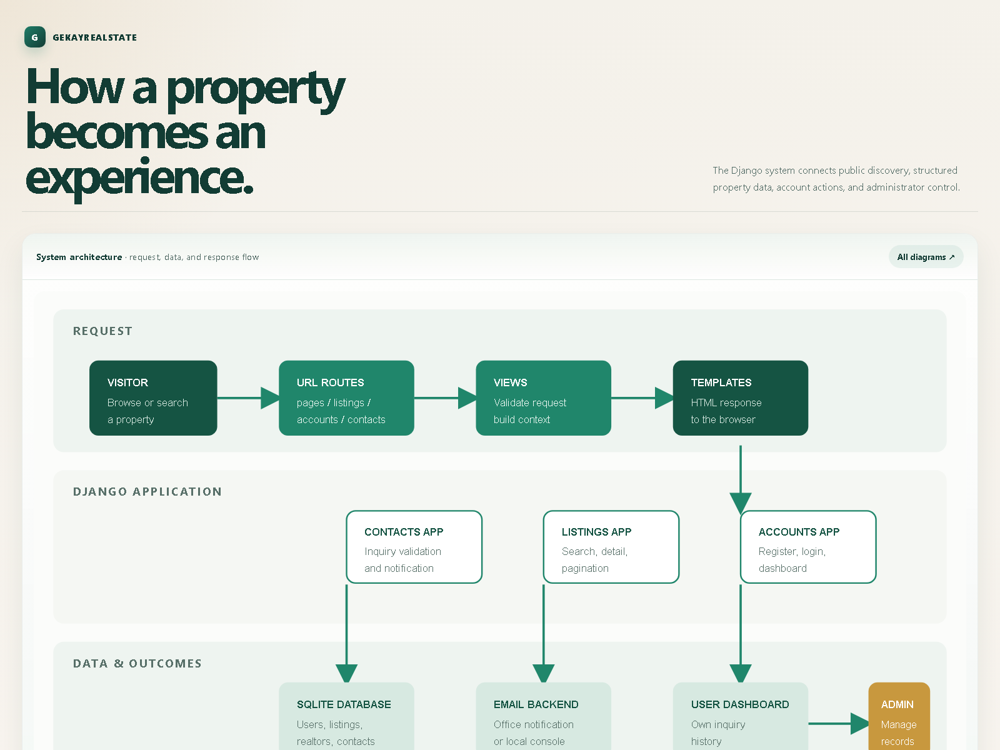

This project diagram provides a broader view of the request, application,
database, email, and administration responsibilities.

---

# 5. System Design

## 5.1 Application modules

| Module | Main design responsibility |
|---|---|
| Pages | Home page, about page, featured listings, and realtor groups |
| Listings | Listing model, index, detail, pagination, and search |
| Realtors | Realtor records and administration |
| Accounts | Registration, login, logout, and authenticated dashboard |
| Contacts | Inquiry model, duplicate check, and email notification |

### User journey

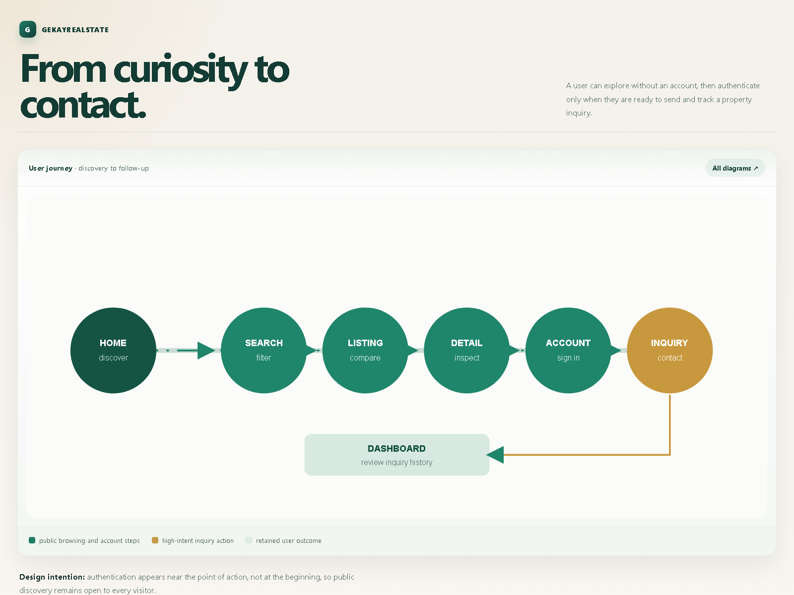

The journey moves from property discovery to search, detail review,
registration or login, inquiry submission, and dashboard review.

### Administrator operations

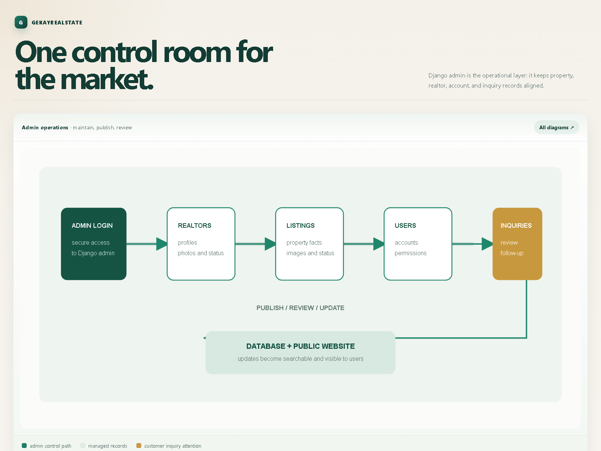

The administrator flow covers maintenance of listings, realtor data, users,
and property inquiries through Django admin.

## 5.2 Database design

### Realtor entity

The `Realtor` entity contains name, photograph, description, phone, email, MVP
status, and hire date. A listing references a realtor.

### Listing entity

The `Listing` entity contains property identity, location, description, price,
bedrooms, bathrooms, garage count, area values, main and additional
photographs, publication status, and listing date.

### Contact entity

The `Contact` entity stores listing name and identifier, visitor name, email,
phone, message, inquiry date, and user identifier. It supports dashboard
history and administrative review.

### Django User entity

Django's built-in `User` entity stores credentials and basic account
information, including username, email, first name, and last name.

## 5.3 Entity relationships

### Figure 5.2 — Entity relationship diagram

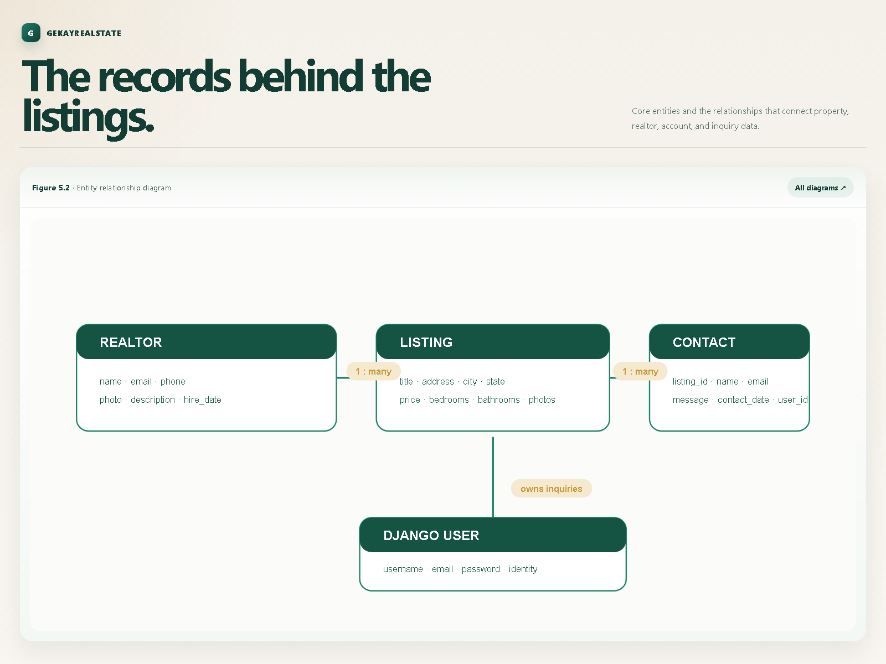

The relationships are:

- one realtor can be associated with many listings;
- one listing can have many contact inquiries; and
- one user can create many contact inquiries.

The dashboard filters contact records by the current user's identifier.

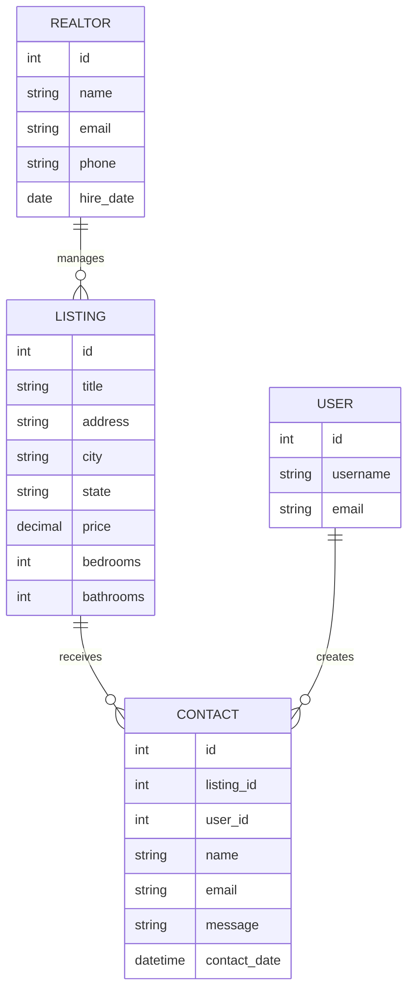

## 5.4 User interface design

The interface uses a shared base template and reusable top bar, navigation,
footer, and alert partials. Listing cards show image, price, location, area,
garage, bedrooms, bathrooms, realtor, and listing age.

## 5.5 Navigation and common layout

Navigation connects the home page, about page, listings, search,
authentication, and dashboard. Breadcrumbs help users understand their
location on listing pages.

## 5.6 Security and access control

Django authentication middleware identifies logged-in users. The dashboard
uses `login_required`. CSRF protection, session middleware, password
validators, authentication functions, secret-key configuration, and allowed
hosts support the security model.

## 5.7 Media and static files

Static CSS, JavaScript, image, and font files are stored in the project static
directory. Realtor and property photographs are media files referenced by
uploaded file URLs.

---

# 6. Implementation

## 6.1 Django configuration

The `djangofirst` project contains `settings.py`, `urls.py`, and `wsgi.py`.
Installed applications include `pages`, `listings`, `realtors`, `accounts`,
`contacts`, and standard Django applications. The project uses a shared
templates directory.

## 6.2 Home and about pages

The home view selects the three most recent published listings and supplies
search choices. The about view orders realtors by hire date and identifies MVP
realtors.

## 6.3 Listing display and pagination

The listing index selects published records and uses a Django paginator with
three listings per page. Previous, current, and next controls appear when
additional pages exist.

## 6.4 Listing detail

The detail view uses `get_object_or_404` to locate the requested record. An
invalid identifier returns Django's standard not-found response.

## 6.5 Listing search

The search view starts with listings ordered by date and applies each supplied
filter independently:

- keyword search against listing description;
- case-insensitive exact city match;
- case-insensitive exact state match;
- maximum bedroom count; and
- maximum price.

Empty parameters do not change the result set.

## 6.6 Realtor management

Realtor records are represented by the `Realtor` model and managed through
Django admin. Listings reference realtors so the responsible professional can
be displayed with each property.

## 6.7 Registration

The registration view validates identity fields, matching passwords, duplicate
username and duplicate email conditions, then creates the user with Django's
`create_user` method and redirects to login.

## 6.8 Login and logout

Valid credentials authenticate the user and redirect to the dashboard. Invalid
credentials return the user to the login page with an error message. Logout is
handled through a POST request and redirects to the home page.

## 6.9 Dashboard

The dashboard is protected by `login_required`. It retrieves `Contact` records
for the current user, orders them by contact date, and renders the dashboard
template.

## 6.10 Contact processing

The contact view reads listing and visitor fields, checks for a previous
inquiry by the same authenticated user, saves valid new inquiries, sends
notification email, and returns the user to the listing.

## 6.11 Duplicate inquiry prevention

The duplicate check prevents a logged-in user from repeatedly submitting an
inquiry for the same listing. This keeps inquiry history useful and reduces
repeated notifications.

## 6.12 Email processing

After saving a new `Contact`, the view uses Django's `send_mail` function.
Local development uses the console email backend when SMTP credentials are not
configured.

## 6.13 Django admin

Each application exposes relevant model records through an admin module.
Django admin is intended for authorised maintenance, not general public
browsing.

## 6.14 Environment configuration

The project reads secret key, allowed hosts, and email credentials from
environment variables so deployment secrets do not need to be stored directly
in source code.

## 6.15 Migrations

Migration files are maintained for listings, realtors, and contacts. Model
changes should be followed by:

```powershell
python manage.py makemigrations
python manage.py migrate
```

---

# 7. Testing

## 7.1 Testing strategy

Testing should cover models, views, routes, authentication, search filters,
templates, migrations, inquiries, and administrator workflows. Both successful
and invalid actions should be tested.

## 7.2 Unit tests

The project includes test modules in `accounts`, `listings`, `contacts`, and
`pages`. Unit tests should verify expected status codes, templates, redirects,
and context data.

## 7.3 Authentication test cases

- successful registration;
- duplicate username;
- duplicate email;
- mismatched passwords;
- valid login;
- invalid login;
- logout; and
- protected dashboard access.

## 7.4 Listing test cases

- published listings are displayed;
- unpublished listings are excluded;
- valid listing detail opens;
- invalid identifier returns not found.

## 7.5 Search and filter test cases

- keyword matching;
- city filtering;
- state filtering;
- bedroom maximum;
- price maximum;
- combined filters; and
- empty search returning the normal listing set.

## 7.6 Contact inquiry test cases

- valid data creates a `Contact`;
- success feedback is shown;
- the visitor returns to the listing; and
- notification email is requested.

## 7.7 Access-control test cases

Unauthenticated dashboard access should redirect to authentication.
Authenticated users should see only their own inquiry records.

## 7.8 Template and UI testing

Check navigation links, image rendering, breadcrumbs, pagination, validation
messages, alerts, and responsive Bootstrap layouts.

## 7.9 Database and migration testing

Confirm that a clean database can be created and that realtor, listing,
contact, and authentication records can be stored and retrieved.

## 7.10 Test execution

Run the Django test suite from the project root:

```powershell
python manage.py test
```

Manual browser testing should cover visitor, registered-user, and administrator
workflows.

---

# 8. User Interface and System Results

## 8.1 Home page

The home page presents the GekayRealEstate identity, navigation, search area,
and recent published listings.

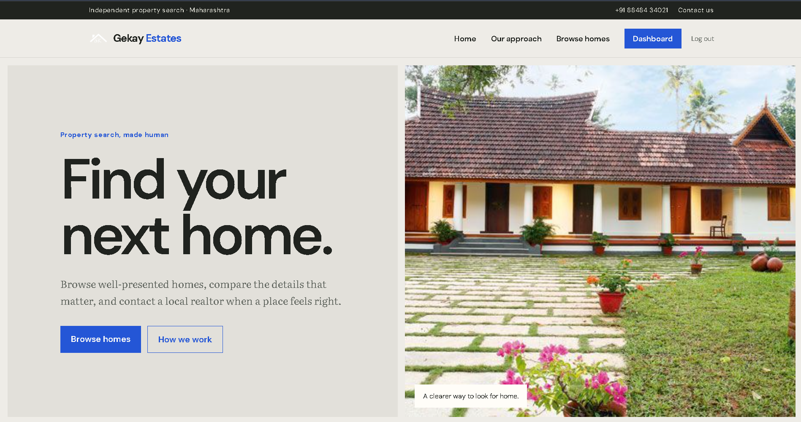

## 8.2 About page and realtor profiles

The about page presents realtor photographs, descriptions, contact information,
and MVP grouping.

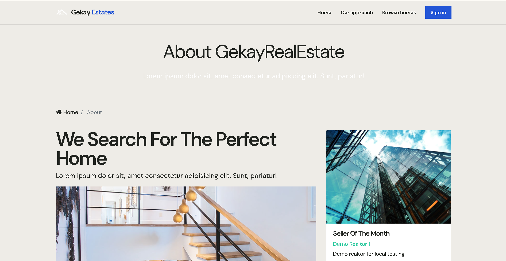

## 8.3 Browse listings

The browse page presents published properties in a responsive card grid with
main image, price, location, and specifications. Pagination supports movement
through the catalogue.

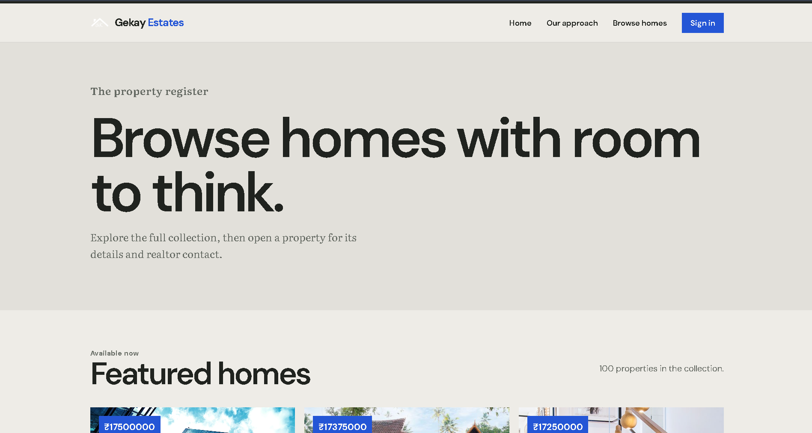

## 8.4 Search results

Search results are based on submitted criteria and preserve those values so
users can understand the active search.

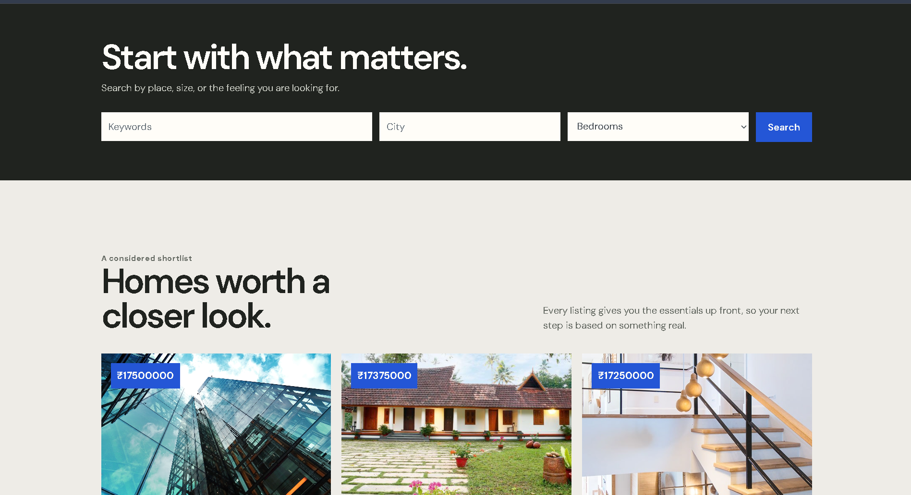

## 8.5 Listing details

The detail page provides description, location, price, measurements,
photographs, realtor information, and the inquiry route.

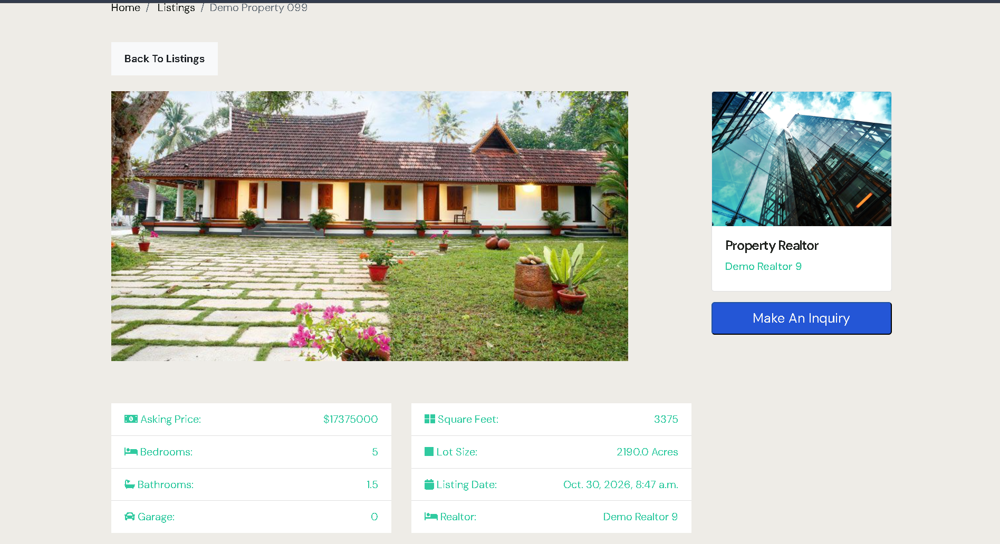

## 8.6 Registration and login

Registration collects identity and password values and reports validation
feedback. Login accepts username and password and reports authentication
feedback.

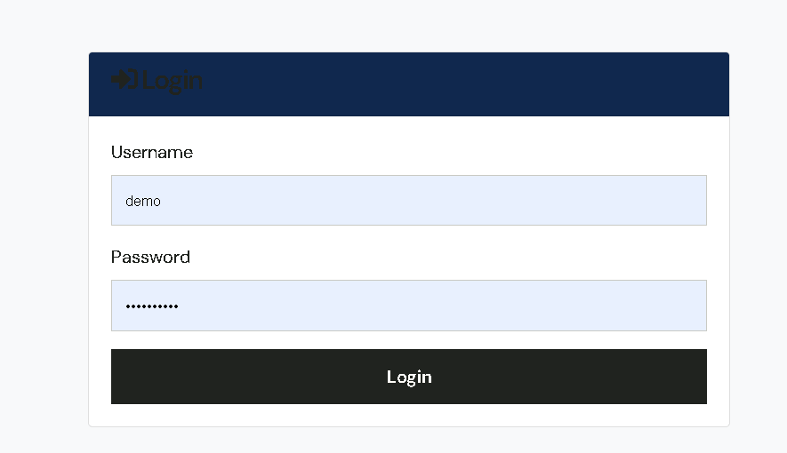

## 8.7 User dashboard

The dashboard displays the authenticated user's inquiry history.

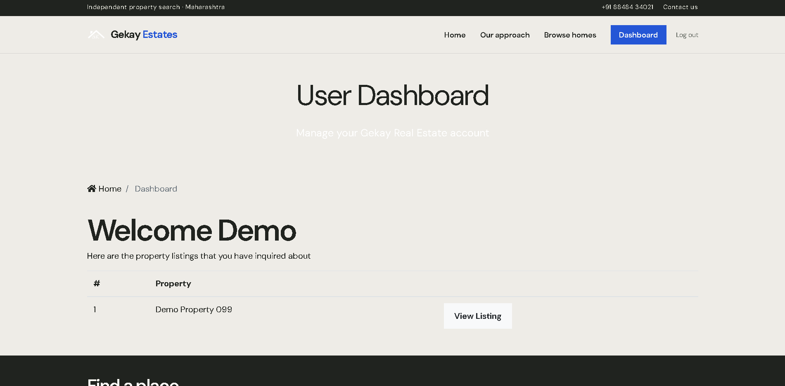

## 8.8 Contact inquiry form

The form collects contact information and a message connected to a specific
listing. Successful submission stores the inquiry and provides confirmation.

## 8.9 Django administration

Authorised administrators can create, update, inspect, and remove managed
records.

## 8.10 Responsive layout

Bootstrap grid classes and responsive navigation patterns support common
desktop and mobile layouts. Custom CSS and JavaScript extend the visual
presentation and image interaction.

---

# 9. Deployment and Maintenance

## 9.1 Local Windows setup

Install Python 3.14, open PowerShell in the project directory, create a
virtual environment, and install the dependencies.

## 9.2 Virtual environment

```powershell
py -3.14 -m venv venv
.\venv\Scripts\Activate.ps1
```

## 9.3 Dependency installation

```powershell
python -m pip install -r requirements.txt
```

## 9.4 Environment file

Create a local `.env` file:

```dotenv
DJANGO_SECRET_KEY=replace-with-a-local-secret
DJANGO_ALLOWED_HOSTS=127.0.0.1,localhost
```

Add SMTP values when external email delivery is required.

## 9.5 Database migration

```powershell
python manage.py migrate
```

## 9.6 Administrator account

```powershell
python manage.py createsuperuser
```

The administrator can then open `/admin/` after starting the server.

## 9.7 Development server

```powershell
python manage.py runserver
```

The application is available at <http://127.0.0.1:8000/>.

## 9.8 Production considerations

Production should use a strong secret key, explicit allowed hosts,
`DEBUG=False`, a production database, secure email credentials, HTTPS,
appropriate media storage, static-file collection, and a production WSGI
server such as Gunicorn.

## 9.9 Backup and maintenance

Back up the database and uploaded media regularly. Review dependencies,
migrations, automated tests, logs, email configuration, and static assets after
each deployment.

---

# 10. Conclusion and Future Scope

## 10.1 Conclusion

GekayRealEstate provides a practical foundation for managing and presenting
property listings online. Its Django architecture separates property data,
realtor data, authentication, inquiries, templates, and project configuration.
Users receive a convenient browsing and inquiry experience, while administrators
receive structured data management through Django admin.

## 10.2 Current limitations

- SQLite is intended mainly for local development.
- There is no complete booking or payment workflow.
- Advanced user roles are not yet modelled.
- Search does not include maps, distance, or saved searches.

## 10.3 Future enhancements

### Advanced user roles

Introduce buyer, realtor, manager, and administrator permissions with
role-based access control.

### Online booking and payment

Allow users to schedule visits, reserve properties, and complete payments
through a secure payment provider.

### Saved and favourite listings

Allow users to save, compare, and receive alerts for properties.

### Advanced property search

Add property type, minimum values, amenities, radius, and map-based search.

### Real-time notifications

Add email, SMS, or in-app notifications for inquiry responses, new listings,
and appointment changes.

### Cloud database and hosting

For larger usage, replace SQLite with PostgreSQL, move uploaded media to cloud
storage, and deploy with HTTPS, managed infrastructure, and continuous
deployment.

---

# Figures and project diagram index

All currently generated HTML figures are connected below. Each link opens the
interactive figure and preserves its accessible SVG description.

| Figure | Description | Link |
|---|---|---|
| Figure 2.1 | Existing and Proposed System Comparison |  |
| Figure 3.1 | Use-Case Diagram |  |
| Figure 3.2 | Data Flow Diagram |  |
| Figure 4.1 | Django MVT Architecture |  |
| Figure 4.2 | Project Directory Structure | Not available in the current image set |
| Figure 5.1 | Application Module / System Architecture Flow |  |
| Figure 5.2 | Entity Relationship Diagram |  |
| Figure 5.3 | URL Routing Diagram |  |
| Figure 5.4 | User Navigation / Journey Flow |  |
| Figure 6.1 | Home Page |  |
| Figure 6.2 | About Page |  |
| Figure 6.3 | Browse Listings Page |  |
| Figure 6.4 | Search Results Page |  |
| Figure 6.5 | Listing Details Page |  |
| Figure 6.6 | Registration Page | Application page screenshot not stored in `doc/img` |
| Figure 6.7 | Login Page |  |
| Figure 6.8 | User Dashboard |  |
| Figure 6.9 | Contact Inquiry Form | Application page screenshot not stored in `doc/img` |
| Figure 6.10 | Django Administration / Admin Operations |  |

## Diagram collection

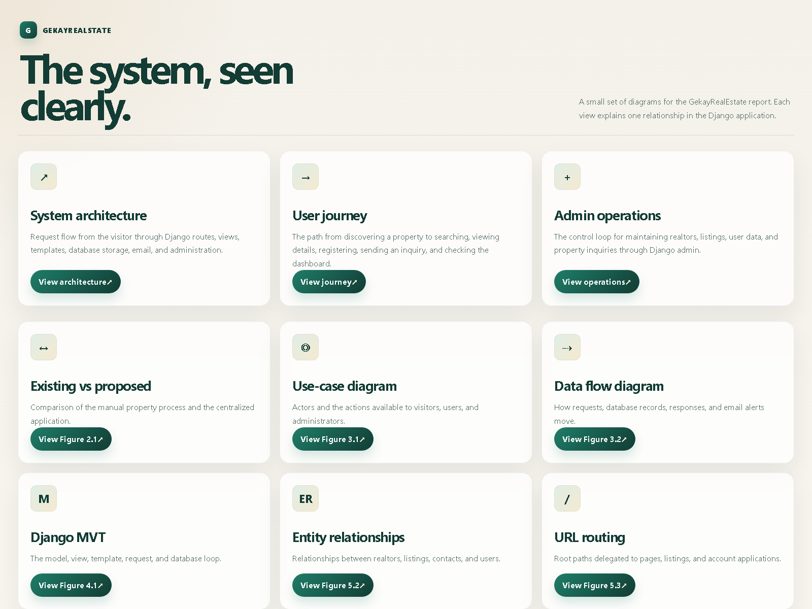

---

# References

1. [Django Documentation](https://docs.djangoproject.com/)
2. [Python Documentation](https://docs.python.org/)
3. [Bootstrap Documentation](https://getbootstrap.com/docs/)
4. [Pillow Documentation](https://pillow.readthedocs.io/)
5. GekayRealEstate project `README.md`
6. GekayRealEstate project source code and migration files
7. [`doc/sample_doc.pdf`](./sample_doc.pdf)
