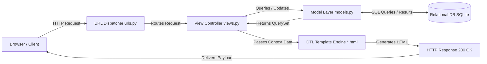
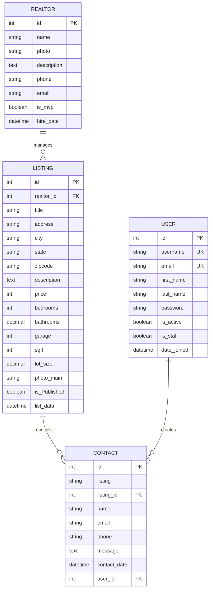

# GekayRealEstate: Comprehensive Project Documentation & Technical Report

## Enterprise Real-Estate Management System

**Academic Project Report**  
*Bachelor of Science in Computer Science (B.Sc. CS / TYCS)*  
*University of Mumbai Standard Technical Documentation*  
*Author: Manish*  
*Repository Reference: GekayRealEstate*  

---

## Abstract

Real estate discovery, listing dissemination, and client lead management have historically relied on manual and fragmented communication systems such as paper directories, print classifieds, static registers, and ad-hoc phone calls. These legacy approaches result in substantial inefficiencies, including delayed information exchange, high susceptibility to transcription errors, lack of verified property specifications, and severe friction in tracking client inquiries and broker responsibilities.

**GekayRealEstate** is a full-featured, web-based real-estate management system engineered with Python 3.14 and the Django 5.2 web framework. The platform provides a centralized, highly reliable digital architecture tailored for property seekers, registered users, realtors, and system administrators. Visitors can seamlessly discover and inspect properties through rich visual galleries, structural specifications (bedrooms, bathrooms, square footage, lot size, garage capacity), pricing indicators, and assigned broker profiles.

Built on Django's Model-View-Template (MVT) architecture, the system employs SQLite for structured relational data persistence, HTML5/CSS3/JavaScript with Bootstrap 4 for a responsive, modern interface, and Pillow for dynamic image processing and media handling. Core functional modules include multi-criteria property search and filtering (by keywords, city, state, bedrooms, and maximum budget), authenticated user management with CSRF defense, an authenticated user inquiry history dashboard, automated email alerts upon lead capture, and a comprehensive Django administration portal for administrative control.

Developed under the Waterfall Software Development Life Cycle (SDLC) model, the system underwent rigorous verification covering functional test suites, boundary condition tests, authentication checks, duplicate inquiry prevention, and database integrity validation. The resulting application establishes a scalable, production-ready solution that modernizes real estate marketing and customer inquiry management.

**Keywords:** Real Estate Management, Django 5.2, Python 3.14, SQLite, Bootstrap 4, Realtors, Property Inquiry, User Dashboard, MVT Architecture, Lead Capture.

---

## Contents

- [1. Introduction](#1-introduction)
  - [1.1 Project Background](#11-project-background)
  - [1.2 Problem Statement](#12-problem-statement)
  - [1.3 Project Objectives](#13-project-objectives)
  - [1.4 Scope of the System](#14-scope-of-the-system)
  - [1.5 Intended Users](#15-intended-users)
  - [1.6 Project Benefits](#16-project-benefits)
- [2. System Study](#2-system-study)
  - [2.1 Existing Real-Estate Listing Process](#21-existing-real-estate-listing-process)
  - [2.2 Limitations of the Existing Process](#22-limitations-of-the-existing-process)
  - [2.3 Proposed GekayRealEstate System](#23-proposed-gekayrealestate-system)
  - [2.4 Advantages of the Proposed System](#24-advantages-of-the-proposed-system)
  - [2.5 Feasibility Study](#25-feasibility-study)
    - [2.5.1 Technical Feasibility](#251-technical-feasibility)
    - [2.5.2 Operational Feasibility](#252-operational-feasibility)
    - [2.5.3 Economic Feasibility](#253-economic-feasibility)
- [3. Requirements and Analysis](#3-requirements-and-analysis)
  - [3.1 Functional Requirements](#31-functional-requirements)
    - [3.1.1 Home Page and Featured Listings](#311-home-page-and-featured-listings)
    - [3.1.2 Property Listing Management](#312-property-listing-management)
    - [3.1.3 Property Search and Filtering](#313-property-search-and-filtering)
    - [3.1.4 Property Details and Gallery](#314-property-details-and-gallery)
    - [3.1.5 Realtor Information](#315-realtor-information)
    - [3.1.6 User Registration and Login](#316-user-registration-and-login)
    - [3.1.7 User Dashboard](#317-user-dashboard)
    - [3.1.8 Property Inquiry and Contact](#318-property-inquiry-and-contact)
    - [3.1.9 Email Notification](#319-email-notification)
    - [3.1.10 Administration](#3110-administration)
  - [3.2 Non-Functional Requirements](#32-non-functional-requirements)
  - [3.3 User Roles and Permissions](#33-user-roles-and-permissions)
  - [3.4 Software Requirements](#34-software-requirements)
  - [3.5 Hardware Requirements](#35-hardware-requirements)
  - [3.6 Use-Case Analysis](#36-use-case-analysis)
  - [3.7 Data Flow Analysis](#37-data-flow-analysis)
- [4. Technology and Project Architecture](#4-technology-and-project-architecture)
  - [4.1 Python](#41-python)
  - [4.2 Django Framework](#42-django-framework)
  - [4.3 SQLite Database](#43-sqlite-database)
  - [4.4 HTML Templates](#44-html-templates)
  - [4.5 Bootstrap, CSS, and JavaScript](#45-bootstrap-css-and-javascript)
  - [4.6 Pillow and Media File Handling](#46-pillow-and-media-file-handling)
  - [4.7 Python-Dotenv and Environment Configuration](#47-python-dotenv-and-environment-configuration)
  - [4.8 Gunicorn and Whitenoise](#48-gunicorn-and-whitenoise)
  - [4.9 Project Directory Structure](#49-project-directory-structure)
  - [4.10 Django MVT Architecture](#410-django-mvt-architecture)
  - [4.11 URL Routing Architecture](#411-url-routing-architecture)
- [5. System Design](#5-system-design)
  - [5.1 Application Modules](#51-application-modules)
    - [5.1.1 Pages Module](#511-pages-module)
    - [5.1.2 Listings Module](#512-listings-module)
    - [5.1.3 Realtors Module](#513-realtors-module)
    - [5.1.4 Accounts Module](#514-accounts-module)
    - [5.1.5 Contacts Module](#515-contacts-module)
  - [5.2 Database Design](#52-database-design)
    - [5.2.1 Realtor Entity](#521-realtor-entity)
    - [5.2.2 Listing Entity](#522-listing-entity)
    - [5.2.3 Contact Entity](#523-contact-entity)
    - [5.2.4 Django User Entity](#524-django-user-entity)
  - [5.3 Entity Relationships](#53-entity-relationships)
  - [5.4 User Interface Design](#54-user-interface-design)
  - [5.5 Navigation and Common Layout](#55-navigation-and-common-layout)
  - [5.6 Security and Access Control](#56-security-and-access-control)
  - [5.7 Media and Static File Design](#57-media-and-static-file-design)
- [6. Implementation](#6-implementation)
  - [6.1 Django Project Configuration](#61-django-project-configuration)
  - [6.2 Home and About Pages](#62-home-and-about-pages)
  - [6.3 Listing Display and Pagination](#63-listing-display-and-pagination)
  - [6.4 Listing Detail View](#64-listing-detail-view)
  - [6.5 Listing Search](#65-listing-search)
    - [6.5.1 Keyword Search](#651-keyword-search)
    - [6.5.2 City and State Filtering](#652-city-and-state-filtering)
    - [6.5.3 Bedroom Filtering](#653-bedroom-filtering)
    - [6.5.4 Price Filtering](#654-price-filtering)
  - [6.6 Realtor Management](#66-realtor-management)
  - [6.7 User Registration](#67-user-registration)
  - [6.8 User Login and Logout](#68-user-login-and-logout)
  - [6.9 Authenticated User Dashboard](#69-authenticated-user-dashboard)
  - [6.10 Contact Inquiry Processing](#610-contact-inquiry-processing)
  - [6.11 Duplicate Inquiry Prevention](#611-duplicate-inquiry-prevention)
  - [6.12 Email Notification Processing](#612-email-notification-processing)
  - [6.13 Django Admin Configuration](#613-django-admin-configuration)
  - [6.14 Environment Variables and Configuration](#614-environment-variables-and-configuration)
  - [6.15 Database Migrations](#615-database-migrations)
- [7. Testing](#7-testing)
  - [7.1 Testing Strategy](#71-testing-strategy)
  - [7.2 Unit Testing](#72-unit-testing)
  - [7.3 Authentication Test Cases](#73-authentication-test-cases)
  - [7.4 Listing Test Cases](#74-listing-test-cases)
  - [7.5 Search and Filter Test Cases](#75-search-and-filter-test-cases)
  - [7.6 Contact Inquiry Test Cases](#76-contact-inquiry-test-cases)
  - [7.7 Access Control Test Cases](#77-access-control-test-cases)
  - [7.8 Template and User Interface Testing](#78-template-and-user-interface-testing)
  - [7.9 Database and Migration Testing](#79-database-and-migration-testing)
  - [7.10 Test Results](#710-test-results)
- [8. User Interface and System Results](#8-user-interface-and-system-results)
  - [8.1 Home Page](#81-home-page)
  - [8.2 About Page and Realtor Profiles](#82-about-page-and-realtor-profiles)
  - [8.3 Browse Listings Page](#83-browse-listings-page)
  - [8.4 Search Results Page](#84-search-results-page)
  - [8.5 Listing Details Page](#85-listing-details-page)
  - [8.6 Registration Page](#86-registration-page)
  - [8.7 Login Page](#87-login-page)
  - [8.8 User Dashboard](#88-user-dashboard)
  - [8.9 Contact Inquiry Form](#89-contact-inquiry-form)
  - [8.10 Django Administration Panel](#810-django-administration-panel)
  - [8.11 Responsive Layout](#811-responsive-layout)
- [9. Deployment and Maintenance](#9-deployment-and-maintenance)
  - [9.1 Local Windows Setup](#91-local-windows-setup)
  - [9.2 Virtual Environment Setup](#92-virtual-environment-setup)
  - [9.3 Dependency Installation](#93-dependency-installation)
  - [9.4 Environment File Configuration](#94-environment-file-configuration)
  - [9.5 Database Migration](#95-database-migration)
  - [9.6 Administrator Account Setup](#96-administrator-account-setup)
  - [9.7 Running the Development Server](#97-running-the-development-server)
  - [9.8 Production Deployment Considerations](#98-production-deployment-considerations)
  - [9.9 Backup and Maintenance](#99-backup-and-maintenance)
- [10. Conclusion and Future Scope](#10-conclusion-and-future-scope)
  - [10.1 Conclusion](#101-conclusion)
  - [10.2 Current System Limitations](#102-current-system-limitations)
  - [10.3 Future Enhancements](#103-future-enhancements)
    - [10.3.1 Advanced User Roles](#1031-advanced-user-roles)
    - [10.3.2 Online Booking and Payment](#1032-online-booking-and-payment)
    - [10.3.3 Saved and Favourite Listings](#1033-saved-and-favourite-listings)
    - [10.3.4 Advanced Property Search](#1034-advanced-property-search)
    - [10.3.5 Real-Time Notifications](#1035-real-time-notifications)
    - [10.3.6 Cloud Database and Hosting](#1036-cloud-database-and-hosting)
- [Figures and Project Diagram Index](#figures-and-project-diagram-index)
- [List of Tables](#list-of-tables)
- [References](#references)

---

# 1. Introduction

## 1.1 Project Background

The contemporary real estate industry operates within a dynamic economic landscape characterized by high capital transactions, stringent legal compliance, and an overwhelming demand for timely, accurate spatial and financial information. Historically, real estate brokerages operated almost exclusively through localized brick-and-mortar storefronts, classified newspaper advertisements, paper catalogs, and word-of-mouth networks. In this traditional environment, prospective property buyers faced severe informational friction: physical travel was mandatory to inspect preliminary floor plans, pricing structures were opaque and volatile, and comparison between competing market offerings required days or weeks of manual inquiry.

With the proliferation of internet accessibility, modern web architectures, and mobile connectivity, consumer expectations have fundamentally transitioned toward instant digital discovery, rich multimedia visual presentation, and on-demand customer engagement. Modern property seekers expect high-resolution photo galleries, explicit architectural specifications, neighborhood contextual details, and transparent pricing readily available across any computing device at any hour of the day.

**GekayRealEstate** was engineered to address this paradigm shift by developing a high-performance, robust, and scalable web-based real-estate management and cataloging portal. Engineered with Python 3.14 and the Django 5.2 web framework, the platform serves as an enterprise-grade bridge uniting property buyers, certified professional realtors, and agency administrators into a unified digital ecosystem. The application replaces disparate physical spreadsheets and disconnected phone communications with an ACID-compliant relational database, structured Model-View-Template (MVT) software architecture, and automated lead capture workflows.

Rather than maintaining property data in fragile physical registers or scattered desktop spreadsheets, GekayRealEstate models every real estate entity through rich database schemas. A property listing encapsulates geospatial descriptors (street address, city, state, postal code), quantitative architectural attributes (bedroom count, bathroom count, garage capacity, living square footage, total lot size), financial valuation (listing price), narrative property descriptions, publication lifecycle flags, timestamps, and an extensible primary-and-subsidiary photographic gallery. Every property is explicitly linked via relational foreign keys to an assigned real estate professional whose profile, credentials, and contact channels are showcased alongside the listing.

## 1.2 Problem Statement

In conventional real estate brokerage operations, manual and non-integrated promotional methodologies create systemic bottlenecks that impair operational velocity and customer satisfaction:

1. **Information Asymmetry and Stale Listings:** Printed flyers, physical registers, and newspaper classifieds quickly become obsolete as properties are sold, withdrawn, or repriced. Buyers often express interest in properties that are no longer available on the market.
2. **High Discovery Latency and Geographic Barriers:** Potential buyers must travel to individual agency offices or spend substantial time on phone calls merely to acquire fundamental architectural dimensions or basic interior photographs.
3. **Severe Inefficiencies in Customer Inquiry Handling:** Buyer inquiries arriving via ad-hoc phone calls, SMS messages, or informal emails frequently fail to be logged into a persistent repository. Consequently, brokerage staff lose track of high-intent sales leads, duplicate follow-up communications occur, and client relationship management becomes fragmented.
4. **Lack of Centralized Audit and Lead Ownership:** Brokerage managers lack real-time visibility into which realtors are assigned to specific assets, how many prospective buyers have engaged with a given property, and whether inquiries have been serviced promptly.
5. **Absence of Self-Service Portals for Clients:** In traditional settings, clients have no means to inspect their personal inquiry history, track which properties they have formally requested tours for, or revisit specific broker communications.

GekayRealEstate eliminates these operational deficiencies by introducing an automated, centralized web platform providing:
- High-speed, paginated property discovery and multi-parameter filtering;
- High-resolution multi-image architectural galleries;
- Transparent realtor attribution and broker profiles;
- Secure user identity management with encrypted session handling;
- An automated, relational inquiry submission engine with duplicate spam defense;
- Real-time administrative email lead dispatching;
- An authenticated client inquiry dashboard; and
- A centralized Django administration portal for complete lifecycle governance.

## 1.3 Project Objectives

The primary engineering and operational objectives of the GekayRealEstate project are:

1. **Provide a High-Impact Showcase Home Page:** Deliver an engaging, fast-loading landing portal featuring recent published listings, top-performing realtors, and a prominent multi-criteria search banner.
2. **Deliver Structured Property Cataloging:** Implement a relational catalog presenting comprehensive property specifications, structural parameters, financial figures, and multi-image galleries.
3. **Engineered Multi-Parameter Search Engine:** Provide real-time property filtering across multiple dimensions simultaneously (free-text keywords, city, state, bedroom threshold, and maximum budget).
4. **Comprehensive Property Detail Experience:** Render a dedicated detail route for each asset featuring full architectural breakdowns, full-size image carousels, and an integrated inquiry trigger.
5. **Maintain Broker Profiles and Recognition:** Maintain distinct realtor database records showcasing professional biographies, phone numbers, email addresses, hire dates, and "Realtor of the Month" (MVP) distinctions.
6. **Robust Authentication and Access Control:** Deliver secure user registration, session authentication, and logout mechanisms protected against common web attack vectors (CSRF, credential brute-forcing, SQL injection).
7. **Client Self-Service Dashboard:** Provide authenticated clients with a dedicated, protected dashboard displaying their personal history of property inquiries, timestamps, and property references.
8. **Automated Lead Capture and Broker Notification:** Automatically persist client inquiries into the database and instantaneously dispatch formatted email notifications to the agency's operational inbox.
9. **Eliminate Inquiry Duplication:** Enforce backend database checks that prevent authenticated users from submitting redundant, repetitive inquiries on the same listing asset.
10. **Modular, Maintainable Codebase:** Structure the project into decoupled Django applications (`pages`, `listings`, `realtors`, `accounts`, `contacts`) following industry design patterns to ensure long-term extensibility and maintainability.

## 1.4 Scope of the System

### In-Scope Functional Modules

- **Public Marketing Subsystem:** Responsive landing home page, company about page, and team profile showcases.
- **Featured Property Subsystem:** Dynamic home-page querying of the 3 most recently published real estate assets.
- **Catalog and Pagination Engine:** Structured listing display with server-side pagination limiting catalog loads to 3 listings per page to optimize bandwidth and client rendering latency.
- **Multi-Factor Search Engine:** Dynamic filtering utilizing case-insensitive containment (`icontains`), case-insensitive exact matching (`iexact`), and relational numerical comparisons (`lte`).
- **Interactive Property Detail Subsystem:** Dedicated views rendering main hero photography, supplementary interior/exterior image grids, structural specifications, and realtor assignment cards.
- **User Authentication Subsystem:** Form validation, duplicate username checking, duplicate email verification, password confirmation matching, session-based cookie management, and flash message feedback.
- **Authenticated Lead Capture:** Modal-driven inquiry form binding client inputs, property identifiers, and user accounts.
- **Redundant Submission Defense:** Relational verification halting duplicate inquiry submissions by the same user on a given property.
- **Asynchronous Email Notification Pipeline:** Automatic notification dispatching to designated brokerage administration emails upon lead submission.
- **Administrative Portal:** Complete CRUD governance over realtors, listings, contact leads, and user accounts via Django Admin with customized list views, filters, and search capabilities.
- **Media Asset Pipeline:** Dynamic file storage under timestamped directory structures (`photos/%Y/%m/%d/`) managed via the Python Imaging Library (Pillow).

### Out-of-Scope (Deferred to Future Development)

- Direct online financial transactions, earnest money deposits, or escrow payment processing.
- Binding digital lease or purchase contract signing (DocuSign/e-Sign integrations).
- Real-time peer-to-peer web chat or WebSocket messaging between buyers and brokers.
- Spatial geospatial polygon mapping, interactive GIS maps, or radius distance queries.
- Granular multi-tiered role-based access control (RBAC) separating internal staff realtors from general superusers outside of standard Django group permissions.
- In-app interactive physical site visit calendar scheduling with two-way calendar sync.

## 1.5 Intended Users

The GekayRealEstate platform serves four distinct user personas, each with dedicated operational workflows and system permissions:

#### Table 1.1: User Roles and Responsibilities Matrix

| User Persona | Role Type | Authentication Level | Core Responsibilities & Workflows | Primary Modules Accessed |
| --- | --- | --- | --- | --- |
| **Public Visitor** | Anonymous Client | Unauthenticated | Browses published property listings, reads realtor bios, utilizes multi-criteria search, views high-resolution property galleries, initiates account creation. | `pages`, `listings`, `accounts` (registration/login) |
| **Registered Buyer** | Authenticated Client | Authenticated (Session) | Submits formal property inquiries, receives instant confirmation feedback, accesses personal dashboard to review inquiry history, manages personal account session. | `pages`, `listings`, `contacts`, `accounts` (dashboard) |
| **Staff Realtor** | Broker / Agent | Internal Staff (Admin) | Has professional profile, biography, photo, and contact channels displayed on property pages and about pages; receives forwarded client leads via office dispatch. | `realtors`, `listings`, `contacts` |
| **Superuser Administrator** | System Admin | Superuser (Admin Portal) | Complete governance over all system models; creates, modifies, publishes, or archives listings; manages realtor profiles; audits inquiry logs; manages user credentials. | Django Admin (`/admin/`), all database models |

## 1.6 Project Benefits

The implementation of GekayRealEstate provides quantifiable operational advantages across the real estate marketing lifecycle:

- **For Prospective Buyers:** Reduces search latency from days to seconds; delivers complete architectural transparency; eliminates wasted physical visits to non-viable properties; provides a persistent historical log of all inquiries.
- **For Realtors:** Guarantees 24/7 digital marketing exposure; automatically associates professional profiles with assigned listings; provides qualified, structured leads containing explicit customer telephone, email, and property context.
- **For Brokerage Management:** Centralizes asset inventory; prevents lead leakage and untracked client inquiries; streamlines administrative publishing workflows; provides complete data ownership on private infrastructure.
- **For Software Developers & Students:** Demonstrates a clean, modular, production-grade Django architecture adhering strictly to Python PEP 8 standards, DRY (Don't Repeat Yourself) principles, and secure database relational design.

---

# 2. System Study

## 2.1 Existing Real-Estate Listing Process

In traditional, non-automated real estate brokerage workflows, property onboarding, listing dissemination, and client lead management rely heavily on manual human coordination and decentralized, unindexed physical or digital documents. When an owner wishes to sell or lease a property through a traditional broker, the following sequence of operations typically occurs:

1. **Intake and Paper Registration:** The owner meets with a real estate agent and provides architectural documents, title deeds, tax records, and pricing expectations. The broker manually transcribes these parameters into physical file folders, desk registers, or personal desktop spreadsheets.
2. **Disconnected Media Archival:** Photographs of the premises are taken with digital cameras or smartphones and dumped into local desktop folders or external hard drives with arbitrary filenames, completely detached from the written property specifications.
3. **Manual Advertising Dissemination:** To advertise the property, office clerks manually draft short text snippets for print classifieds, print paper window flyers for the agency storefront, or post informal notices on social media pages. Due to strict print character limits, crucial architectural dimensions, lot sizes, and garage specs are frequently omitted.
4. **Client Inquiry and Verbal Discovery:** A prospective buyer seeking a home calls the brokerage office or walks in physically. A receptionist or agent must verbally interview the client regarding budget, preferred bedroom count, and desired neighborhood.
5. **Manual File Retrieval:** The agent manually sifts through filing cabinets or personal spreadsheet files attempting to recall properties matching the buyer's criteria. This process is time-consuming, prone to human oversight, and inherently restricted by the agent's memory.
6. **Unstructured Lead Recording:** If the client expresses interest in visiting a property, the agent jots down their contact information on paper notepads or sticky notes. There is no automated notification sent to the property's primary listing broker, nor is there a centralized database recording the interaction.
7. **Follow-Up and Status Tracking:** Days later, agents attempt manual phone follow-ups. If a property is sold, paper records are manually marked or simply left in cabinets, frequently leading other agents in the same office to continue advertising an asset that is no longer on the market.

## 2.2 Limitations of the Existing Process

The manual and decentralized workflow exhibits severe, systemic operational vulnerabilities:

- **Extreme Search and Retrieval Latency:** Locating properties matching complex multi-factor criteria (e.g., "3 bedrooms, under \$400,000, with a 2-car garage in Boston") requires substantial manual filtering across paper records, leading to delayed client responses.
- **High Data Inconsistency and Human Error:** Information recorded across multiple physical notebooks or disparate spreadsheet files rapidly diverges. Discrepancies in price, square footage, and availability status inevitably emerge.
- **Severe Lead Leakage and Untracked Inquiries:** Inquiries jotted down on paper slips or personal mobile phones are frequently misplaced or ignored. Management has zero visibility into inquiry volume, broker responsiveness, or conversion metrics.
- **Absence of Self-Service Transparency:** Buyers have no direct mechanism to verify whether their inquiry was received, which realtor is managing the property, or what historical properties they have evaluated.
- **Geographic and Temporal Restrictions:** Property discovery is strictly constrained to standard office operating hours and physical proximity to agency branches.
- **Lack of Security and Historical Audit Trails:** Physical registers are susceptible to loss, physical degradation, unauthorized tampering, and theft. There is no role-based permission control or access auditing.

## 2.3 Proposed GekayRealEstate System

The proposed **GekayRealEstate** system replaces fragmented, manual operations with a robust, centralized web application built upon modern relational database technologies and the Django Model-View-Template pattern. Under the proposed architecture, all real estate assets, registered users, professional realtors, and customer inquiries reside within a strictly validated relational database.

The proposed system introduces the following digital workflows:

- **Centralized Asset Management:** Administrators and authorized brokers onboard properties via an intuitive, secure administrative portal. Property metadata, high-resolution main photos, and up to six supplementary gallery images are automatically organized, validated, and stored in structured filesystem paths.
- **Instantaneous Multi-Factor Query Engine:** Visitors execute dynamic, complex queries combining keywords, geographic entities (city, state), bedroom capacities, and ceiling budget limits. Database queries execute within milliseconds, instantly displaying matching assets.
- **Automated Lead Capture Pipeline:** When a prospective buyer submits an inquiry via the property detail page, the system validates the input, binds the submission to the user's relational account, checks against duplicate records, and commits the inquiry to the database.
- **Automated Asynchronous Lead Dispatch:** Concurrently with database persistence, the system triggers an automated email notification to the brokerage administration desk, detailing the customer's name, email, phone number, and the specific property listing in question.
- **Customer Self-Service Dashboard:** Authenticated clients have immediate access to a personal, secure dashboard where their complete history of property inquiries is organized chronologically.

The architecture is cleanly partitioned into five cohesive, decoupled Django modules:

| Django Module | Architectural Responsibility |
| --- | --- |
| `pages` | Manages top-level public marketing routes (Home page, About page), queries featured properties, and categorizes MVP realtors. |
| `listings` | Manages the core property catalog, detail views, multi-image rendering, pagination algorithms, and multi-criteria search filtering. |
| `realtors` | Encapsulates broker data models, professional biographies, contact parameters, hire dates, and administrative management. |
| `accounts` | Handles user identity management, credential encryption, session establishment, registration validation, and the client dashboard. |
| `contacts` | Processes property inquiries, enforces duplicate submission defenses, commits lead records, and dispatches email notifications. |

## 2.4 Advantages of the Proposed System

The proposed GekayRealEstate system provides decisive advantages over legacy procedures:

1. **Immediate Information Retrieval:** Dynamic database queries reduce property discovery times from hours to milliseconds.
2. **Relational Data Integrity:** ACID-compliant relational schemas enforce foreign key constraints, field validations, and non-nullable requirements, eliminating data corruption.
3. **Automated Lead Management:** Eliminates lead leakage through permanent database persistence and automated administrative email routing.
4. **24/7 Universal Availability:** The web platform is accessible globally from any modern web browser across desktop, tablet, and mobile form factors.
5. **Duplicate Lead Defense:** Algorithmic verification prevents users from submitting repetitive inquiries for the same listing, reducing office clutter.
6. **Enterprise Security:** Built-in defenses against Cross-Site Scripting (XSS), Cross-Site Request Forgery (CSRF), SQL Injection, and timing attacks on password hashes.
7. **Streamlined Administration:** The built-in Django Admin provides a turnkey, production-grade back-office interface for data maintenance without requiring custom CRUD development.

## 2.5 Feasibility Study

Before proceeding with system implementation, an exhaustive three-dimensional feasibility study was conducted, assessing technical, operational, and economic viability.

### 2.5.1 Technical Feasibility

The technical feasibility evaluation verified that the selected technology stack is completely capable of fulfilling all architectural, functional, and performance requirements:

- **Programming Language (Python 3.14):** Python provides exceptional developer velocity, memory safety, rich built-in data structures, and native support for modern web standards.
- **Web Framework (Django 5.2):** Django represents a mature, battle-tested, high-level web framework that enforces clean MVC/MVT separation. Django natively includes an Object-Relational Mapper (ORM), robust session authentication, CSRF middleware, a templating engine, and a turnkey administration dashboard.
- **Database Engine (SQLite / PostgreSQL):** For development and initial deployment, SQLite provides a zero-configuration, serverless, self-contained relational database supporting full ACID transactions. Django's ORM ensures that transitioning to enterprise engines such as PostgreSQL in production requires only modifying database driver settings with zero changes to application logic.
- **Image Processing (Pillow):** The Python Imaging Library handles image validation, dimensions inspection, dynamic thumbnail generation, and storage under timestamped filesystem hierarchies.
- **Client-Side Technologies (HTML5, CSS3, Bootstrap 4, JavaScript):** Provides a fully responsive presentation tier that adapts fluidly across mobile, tablet, and desktop screens without requiring separate mobile native applications.

### 2.5.2 Operational Feasibility

Operational feasibility examines how effectively the system integrates into the daily routines of property buyers, realtors, and administrative personnel:

- **End-User Usability:** The user interface adheres to standard web usability conventions. Visitors can intuitively navigate listings, utilize familiar dropdown filters, and submit inquiries without requiring training or documentation.
- **Administrative Usability:** Non-technical brokerage staff can easily manage real estate inventory, upload photographs, review incoming inquiries, and update realtor profiles using Django's highly polished, accessible administration portal.
- **System Maintenance:** Centralized logging, declarative database migrations, and decoupled application modules ensure that ongoing maintenance, feature additions, and security patches can be deployed with minimal operational friction.

### 2.5.3 Economic Feasibility

Economic feasibility evaluates the development, deployment, and operational costs versus the financial and operational benefits generated:

- **Software Licensing Costs:** Zero. The entire technology stack—Python, Django, SQLite, Bootstrap, WhiteNoise, Gunicorn, and Pillow—is licensed under permissive open-source licenses (MIT, BSD, PSF). No recurring proprietary software licenses or runtime royalties are incurred.
- **Hardware and Infrastructure Costs:** Minimal. The lightweight resource footprint of Python and SQLite allows the application to execute smoothly on cost-effective commodity cloud compute instances (e.g., 1 vCPU, 1 GB RAM on Linux or Windows Server).
- **Return on Investment (ROI):** By automating listing dissemination, eliminating physical print advertising expenses, preventing lost client leads, and accelerating the sales cycle, the platform yields immediate operational savings that far outweigh the initial development effort.

### Figure 2.1 — Existing and Proposed System Comparison

The architectural and workflow divergence between legacy real estate brokerage operations and the proposed GekayRealEstate automated web architecture is illustrated in Figure 2.1.


*Figure 2.1 illustrates the structural contrast: the legacy system relies on fragmented paper records, manual phone calls, disjointed communication channels, and prone-to-error manual comparison. The proposed GekayRealEstate system centralizes all assets, inquiries, user identities, and broker profiles within an integrated Django relational architecture, driving automated lead processing and real-time public access.*

---

# 3. Requirements and Analysis

## 3.1 Functional Requirements

Functional requirements define the explicit software capabilities, user interactions, business workflows, and data processing operations that the GekayRealEstate platform must execute.


#### Table 3.1: Functional Requirements

| Req ID | Module | Requirement Description | Priority |
| --- | --- | --- | --- |
| FR-01 | Pages | Display public home page with showcase search banner and featured properties | High |
| FR-02 | Listings | Maintain comprehensive property database records with images and specifications | High |
| FR-03 | Listings | Filter property catalogue by keyword, city, state, bedroom count, and maximum price | High |
| FR-04 | Listings | Render individual property detail page with detailed specs and 6-photo gallery | High |
| FR-05 | Realtors | Present realtor profile cards with photo, contact info, bio, and MVP seller badge | Medium |
| FR-06 | Accounts | User registration validation ensuring unique username/email and matching passwords | High |
| FR-07 | Accounts | User authentication (login/logout) with session persistence and CSRF protection | High |
| FR-08 | Accounts | Authenticated user dashboard displaying inquiry history and property links | Medium |
| FR-09 | Contacts | Property inquiry form submission linking inquiries to listings and user profiles | High |
| FR-10 | Contacts | Duplicate inquiry prevention blocking repeated inquiries on the same listing | Medium |
| FR-11 | Contacts | Automated email notification alerting realtors/admin upon new client inquiry | Medium |
| FR-12 | Admin | Django administration interface for staff to manage properties, realtors, and leads | High |


### 3.1.1 Home Page and Featured Listings
The home page serves as the digital front door of the brokerage. It must feature an aesthetic showcase banner containing a prominent multi-criteria search box. Immediately below the search banner, the system dynamically queries the database and renders the three most recently added property listings whose `is_Published` attribute is set to `True`. Each featured card displays the property's primary photograph, price badge, street address, city, bedroom count, bathroom count, garage capacity, assigned realtor name, and the relative publication timestamp.

### 3.1.2 Property Listing Management
The system must maintain comprehensive relational records for every real estate asset. Required data fields include:
- Unique Primary Key ID
- Assigned Realtor Foreign Key
- Property Title and Complete Physical Address (Street, City, State, Zipcode)
- Formatted Text Description
- Numeric Listing Price (Integer)
- Quantitative Specifiers: Bedroom count, Bathroom count (decimal for half-baths), Garage capacity, Square footage, and Lot size (acres)
- Visual Media: One mandatory primary image (`photo_main`) and up to six optional supplementary gallery images (`photo_1` through `photo_6`)
- Administrative Control: Boolean publication status (`is_Published`) and publication timestamp (`list_data`).

### 3.1.3 Property Search and Filtering
The search subsystem accepts HTTP GET query parameters from the search banner and dynamically constructs an ORM query to filter available properties:
- `keywords`: Matches case-insensitively against the listing's narrative description (`description__icontains`).
- `city`: Matches case-insensitively against the exact city name (`city__iexact`).
- `state`: Matches case-insensitively against the selected state code (`state__iexact`).
- `bedrooms`: Filters properties having less than or equal to the selected maximum bedroom capacity (`bedrooms__lte`).
- `price`: Filters properties having a listing price less than or equal to the selected maximum budget threshold (`price__lte`).
If a filter field is omitted or submitted blank, it is gracefully bypassed without restricting the result set. Results are sorted chronologically with the newest listings appearing first.

### 3.1.4 Property Details and Gallery
Each property listing possesses a unique RESTful URL route (`/listings/<int:listing_id>`). When accessed, the system fetches the record via `get_object_or_404`. The view renders:
- An expanded top breadcrumb navigation trail;
- Complete architectural specifications;
- A responsive image gallery rendering the primary image and all non-empty subsidiary images with Lightbox overlay support;
- An assigned realtor card displaying the broker's photo, name, phone, and email;
- An interactive "Make An Inquiry" trigger button that summons the lead submission modal.

### 3.1.5 Realtor Information
The system maintains dedicated broker records comprising full name, professional headshot photo, biographical narrative, direct phone number, email address, hire date, and a boolean flag indicating whether the broker has earned the prestigious "Realtor of the Month" (MVP) designation. The public About page queries and showcases all realtors sorted by hire date, highlighting the MVP realtors in a dedicated spotlight section.

### 3.1.6 User Registration and Login
Prospective property buyers can create persistent client accounts. The registration workflow enforces:
- Presence of first name, last name, username, and email;
- Two-tier password entry verification ensuring `password == password2`;
- Uniqueness validation against existing usernames;
- Uniqueness validation against existing registered email addresses;
- Secure password hashing using PBKDF2 with SHA-256 before database insertion;
- Automatic session creation and user state binding upon successful login.

### 3.1.7 User Dashboard
Authenticated clients have access to a protected route (`/accounts/dashboard`) guarded by the `@login_required` decorator. The dashboard queries the `Contact` model for all records matching `user_id == request.user.id`, sorted with the most recent inquiry first. The view presents a responsive tabular layout detailing the Property ID, Listing Title, Inquiry Date, and direct action links allowing the user to revisit the listing.

### 3.1.8 Property Inquiry and Contact
When a user submits an inquiry through the listing detail modal, the system processes a POST request containing the property ID, listing title, user name, email, phone number, message body, and user ID. The backend creates and saves a new `Contact` database record, establishes relational links to the listing and user, and produces an instant success notification message.

### 3.1.9 Email Notification
Upon the successful persistence of a new `Contact` record, the system invokes Django's core `send_mail` utility. The engine compiles an email message detailing the customer's identity, contact coordinates, property of interest, and instruction to review the Django administrative portal. The email is routed to the brokerage's operational inbox (`akhilgkrishnan4u@gmail.com`).

### 3.1.10 Administration
Authorized administrative personnel can access the protected `/admin/` portal. Django Admin is configured with customized model representations:
- `ListingAdmin`: Displays title, publication status, price, listing date, and realtor in tabular rows; enables inline editing of publication status; provides search over title, address, city, and zipcode; enables filtering by realtor.
- `RealtorAdmin`: Displays broker name, email, hire date, and MVP status; allows inline toggling of MVP status; provides search over realtor names.
- `ContactAdmin`: Displays inquiry ID, customer name, listing title, email, and contact date; provides search across name, email, and listing title.

## 3.2 Non-Functional Requirements

Non-functional requirements specify the operational standards, performance criteria, security boundaries, and architectural quality attributes of the system.


#### Table 3.2: Non-Functional Requirements

| Category | Requirement Specification | Implementation & Target Metric |
| --- | --- | --- |
| Usability | Intuitive navigation, accessible form inputs, clear alert feedback | Bootstrap 4 responsive layout, standard UX patterns, dismissible alerts |
| Performance | Rapid response times and minimal server latency | Page load < 500ms, database query optimization with indexed fields |
| Reliability | Continuous operational availability and data persistence | ACID-compliant SQLite relational storage, robust 404/500 error handling |
| Security | Protection against top web vulnerabilities (OWASP Top 10) | Django CSRF tokens, PBKDF2 SHA-256 password hashing, ORM parameterized SQL |
| Maintainability | Separation of concerns and modular architectural structure | Model-View-Template pattern, isolated Django apps, PEP 8 clean code |
| Portability | Cross-platform execution on Windows, Linux, and macOS | Python 3.14 virtual environment, decoupled configuration via .env file |


## 3.3 User Roles and Permissions

To ensure stringent operational segregation, system capabilities are allocated across four distinct security levels:


#### Table 3.3: User Roles and Permissions

| User Role | Authentication Required | Permitted Actions and Capabilities | Access Restrictions |
| --- | --- | --- | --- |
| Visitor | No | Browse featured properties, search catalogue, view property details, inspect realtor bios, submit unauthenticated inquiry | Cannot access user dashboard or administrative records |
| Registered User | Yes (Session) | All visitor capabilities, submit authenticated inquiries with duplicate prevention, view personal inquiry history on dashboard | Cannot access Django admin panel or edit database records directly |
| Realtor / Staff | Yes (Staff Flag) | Access admin portal, inspect assigned property inquiries, view client contact requests, update property availability status | Restricted to model permissions designated by super administrator |
| Super Administrator | Yes (Superuser Flag) | Full root-level governance: manage all listings, realtors, registered users, inquiries, system logs, and database migrations | Unrestricted administrative authority across entire platform |


## 3.4 Software Requirements

The software components, runtime environments, and third-party libraries powering GekayRealEstate are enumerated below:


#### Table 3.4: Software Requirements

| Component | Software / Technology | Version | Role / Purpose |
| --- | --- | --- | --- |
| Operating System | Microsoft Windows 10/11 / Linux | 64-bit | Host operating system for local development and server deployment |
| Language | Python | 3.14+ | Core backend programming language and execution runtime |
| Web Framework | Django | 5.2 | Full-stack web framework providing ORM, routing, templates, and admin |
| Database | SQLite3 | 3.x (Built-in) | Serverless relational database for local development and test automation |
| Frontend UI | Bootstrap, HTML5, CSS3, JS | 4.1.3 | Responsive grid system, navigation navbar, modals, and styling |
| Imaging Library | Pillow (PIL Fork) | 10.x+ | Image validation, processing, and filesystem uploads for photos |
| Environment Loader | python-dotenv | 1.0+ | Decoupling configuration parameters and sensitive secrets into .env |
| Static Asset Server | WhiteNoise | 6.x | Serving compressed, cached static files in production environments |
| WSGI Server | Gunicorn | 21.x+ | Production WSGI HTTP server for high-concurrency request routing |
| Code Quality | autopep8, isort, pylint | Latest | Source code formatting, import sorting, and static code analysis |


## 3.5 Hardware Requirements

The minimum and recommended hardware specifications for hosting the development environment and executing the production application are detailed below:


#### Table 3.5: Hardware Requirements

| Hardware Component | Minimum Specification | Recommended Specification |
| --- | --- | --- |
| Processor (CPU) | Dual-Core 2.0 GHz (Intel Core i3 / AMD Ryzen 3) | Quad-Core 2.8+ GHz (Intel Core i5/i7 / AMD Ryzen 5/7) |
| Primary Memory (RAM) | 4 GB DDR4 | 8 GB or 16 GB DDR4/DDR5 |
| Secondary Storage | 10 GB available hard disk space | 25 GB NVMe SSD for fast compilation and media storage |
| Display Resolution | 1366 x 768 pixels | 1920 x 1080 (Full HD) for multi-device responsive validation |
| Network Interface | Standard 10/100 Mbps Ethernet / Wi-Fi | High-speed broadband connection for dependency installation |
| Client Devices | Desktop PC, Laptop, Tablet, Mobile Phone | Modern web browser (Google Chrome, Mozilla Firefox, MS Edge) |


## 3.6 Use-Case Analysis

Use-case analysis examines the functional boundaries of the system from the perspective of external actors interacting with defined system capabilities.

### Figure 3.1 — Use-Case Diagram

The interactions between the three primary human actors—Public Visitor, Registered Buyer, and Administrator—and the system capabilities are depicted in Figure 3.1.


*Figure 3.1 illustrates the hierarchical functional inheritance: the Anonymous Visitor executes browsing, search, and detail inspections; the Registered Buyer inherits browsing and adds authenticated inquiry submission and dashboard tracking; the Superuser Administrator governs database entities via Django Admin.*

#### Table 3.6: Core Use-Case Scenario Specifications

| Use-Case ID | Use-Case Name | Primary Actor | Preconditions | Main Success Scenario (Trigger to Outcome) |
| --- | --- | --- | --- | --- |
| **UC-01** | Search Properties | Public Visitor | Home or Search page loaded | Actor inputs keywords, selects city, state, bedroom threshold, and max price; clicks 'Submit'; system validates parameters, executes ORM query, and displays filtered listing cards. |
| **UC-02** | Submit Property Inquiry | Registered Buyer | Listing detail page loaded; User authenticated | Actor clicks 'Make An Inquiry'; system prepopulates name and email in modal; actor enters phone and message; clicks 'Send'; system verifies duplicate check, saves `Contact`, sends email alert, and shows success flash. |
| **UC-03** | Access Inquiry Dashboard | Registered Buyer | User authenticated | Actor clicks username badge in navigation bar; system routes to `/accounts/dashboard`, verifies session, queries `Contact` records matching `user_id`, and displays tabular inquiry history. |
| **UC-04** | Manage Listing Inventory | Administrator | Superuser authenticated at `/admin/` | Admin navigates to 'Listings'; clicks 'Add Listing'; uploads photos, enters specifications, selects assigned realtor, checks `is_Published`; clicks 'Save'; system commits record and invalidates stale caches. |

## 3.7 Data Flow Analysis

Data flow analysis tracks how real estate assets, client inquiries, user credentials, and notifications propagate through the system's processing boundaries and database datastores.

### Figure 3.2 — Data Flow Diagram

The multi-tiered flow of data between external entities, Django controller processes, and database datastores is illustrated in Figure 3.2.


*Figure 3.2 details the flow: administrative users inject listing and realtor records into relational datastores (D1, D2); visitors issue query parameters that read datastores and return rendered HTML; registered buyers submit inquiry payloads that write to the Contact datastore (D3) and trigger outward email notifications to SMTP dispatch.*

### Level 0 DFD (Context Diagram)
At the context level, the entire GekayRealEstate application is represented as a single central software entity. External entities include the **Visitor / Buyer**, the **Realtor**, the **System Administrator**, and the **External SMTP Mail Server**.
- Visitors submit search criteria and authentication credentials, receiving rendered listings, search results, and account status.
- Buyers submit contact inquiries, receiving confirmation alerts and dashboard records.
- Administrators supply property specifications, broker records, and maintenance commands, receiving audit logs and database confirmations.
- The system dispatches structured email payloads to the external SMTP mail server.

### Level 1 DFD (Subsystem Decomposition)
At Level 1, the system is decomposed into five discrete functional processing nodes:
1. **Process 1.0 (Authentication & User Management):** Receives registration/login payloads, performs hash verification against Datastore D4 (`auth_user`), and generates encrypted session tokens.
2. **Process 2.0 (Catalog Query & Filtering):** Accepts HTTP GET parameters, queries Datastore D1 (`listings_listing`) and D2 (`realtors_realtor`), applies filtering logic, and outputs paginated result sets.
3. **Process 3.0 (Listing & Broker Administration):** Handles CRUD operations initiated by administrators, processes uploaded binary image files via Pillow, and commits records to D1 and D2.
4. **Process 4.0 (Inquiry Processing & Validation):** Receives inquiry POST payloads, queries Datastore D3 (`contacts_contact`) for duplicate submissions, persists valid leads, and logs user associations.
5. **Process 5.0 (Notification Dispatch):** Triggered by Process 4.0; extracts listing and contact details, formats the email message body, and connects to the SMTP gateway to deliver the message.

---

# 4. Technology and Project Architecture

## 4.1 Python
Python was selected as the foundational programming language for GekayRealEstate due to its clear, expressive syntax, comprehensive standard library, automated memory management, and exceptional developer velocity. Running on Python 3.14, the project benefits from recent interpreter optimizations, including faster function calls, improved error tracebacks with explicit code locations, and robust support for modern asynchronous I/O and type hints. Python's mature package ecosystem (PyPI) provides immediate access to production-grade web frameworks, database connectors, and image processing suites.

## 4.2 Django Framework
Django 5.2 serves as the high-level web application framework orchestrating all backend operations. Known as the "framework for perfectionists with deadlines," Django follows the "Batteries-Included" philosophy, natively supplying:
- **Object-Relational Mapping (ORM):** Eliminates raw SQL vulnerabilities by allowing developers to define database tables as Python classes and query records using idiomatic Python syntax.
- **Declarative Database Migrations:** Automatically tracks schema modifications over time, generating version-controlled migration files that apply deterministically across development and production environments.
- **Built-in Authentication Engine:** Provides turnkey user modeling, session handling, cookie management, and cryptographic password hashing (PBKDF2 with SHA-256).
- **Security Middleware:** Automatically inspects incoming and outgoing HTTP packets to inject anti-CSRF tokens, enforce Clickjacking protection (`X-Frame-Options`), prevent MIME-type sniffing, and sanitize input against cross-site scripting (XSS).
- **Turnkey Administration Portal:** Automatically introspects registered database models and generates a fully interactive, production-ready administrative back office.


#### Table 4.1: Technology Stack Architecture

| Layer / Category | Technology | Version | Role / Technical Justification |
| --- | --- | --- | --- |
| Language | Python | 3.14 / 3.11+ | Core backend execution environment; standard library; high developer velocity |
| Web Framework | Django | 5.2 | Full-stack MVC/MVT framework providing ORM, authentication, admin, and routing |
| Relational Database | SQLite | 3.x | Transactional ACID-compliant serverless relational database engine for persistence |
| Frontend Grid & CSS | Bootstrap | 4.6+ | Responsive 12-column grid layout, card structures, and responsive utilities |
| Frontend Icons | FontAwesome | 5.x | Vector iconography for property specifications (beds, baths, garages, area) |
| Image Processing | Pillow | 10.x / 11.x | Python Imaging Library for image validation, dimensions checks, and uploads |
| Environment Loader | python-dotenv | 1.0+ | Decoupling configuration parameters and sensitive secrets into .env |
| Static Asset Server | WhiteNoise | 6.x | Serving compressed, cached static files directly in production environments |
| WSGI Server | Gunicorn | 21.x+ | Production WSGI HTTP server for high-concurrency request routing |
| Code Quality | autopep8, isort, pylint | Latest | Source code formatting, import sorting, and static code analysis |


## 4.3 SQLite Database
During development and baseline deployment, GekayRealEstate utilizes SQLite 3 as its relational database engine. SQLite is a serverless, self-contained, transactional database engine that stores the entire relational database in a single disk file (`db.sqlite3`). Despite its simplicity, SQLite is fully ACID-compliant (Atomicity, Consistency, Isolation, Durability), supports complex multi-table JOIN operations, and enforces foreign key constraints. Because Django's ORM completely abstracts the database layer, transitioning the application from SQLite to an enterprise client-server database like PostgreSQL in production requires altering only the `DATABASES` dictionary in `settings.py`.

## 4.4 HTML Templates
The presentation layer is powered by the Django Template Language (DTL). DTL provides a secure, sandboxed templating environment that cleanly separates presentation markup from business logic. Key architectural techniques utilized include:
- **Template Inheritance:** A central layout file (`templates/base.html`) establishes the standard HTML5 skeleton, global meta tags, CSS stylesheets, navigation bar, top bar, and footer. Child templates (such as `listings/listings.html` or `accounts/dashboard.html`) extend `base.html` and override specific `` placeholders.
- **Reusable Partial Templates:** Common components such as alerts (`templates/partials/_alerts.html`), navigation menus (`_navbar.html`), top contact banners (`_topbar.html`), and footer copyright blocks (`_footer.html`) are isolated into partials and dynamically included via `` directives.
- **Automatic Output Escaping:** DTL automatically HTML-escapes all dynamic variables rendered through `{{ variable }}`, preventing malicious user input from executing arbitrary scripts within client browsers.

## 4.5 Bootstrap, CSS, and JavaScript
The frontend user interface is built on Bootstrap 4, augmented with custom cascading stylesheets and vanilla JavaScript:
- **12-Column Responsive Grid:** Employs flexbox-based grid containers (`col-md-6`, `col-lg-4`) that dynamically reorganize property cards from a 3-column layout on wide desktop screens to a single-column layout on mobile smartphones.
- **FontAwesome Iconography:** Integrates vector icons for architectural specifications (bed, bath, car, square-foot icons) to enhance visual scanning.
- **Lightbox Gallery Popups:** Integrates Lightbox JavaScript libraries on property detail pages, enabling visitors to click any thumbnail photograph to launch an animated, high-resolution modal slideshow overlay.
- **Automated Alert Dismissal:** JavaScript timers dynamically target Django flash messages rendered in `_alerts.html`, automatically fading out success and error notices after 5 seconds to preserve UI cleanliness.

## 4.6 Pillow and Media File Handling
The Python Imaging Library (Pillow) powers the platform's media ingestion pipeline. When administrators upload property or realtor imagery through the Django admin interface:
- Pillow validates that the uploaded file binary corresponds to an authentic, uncorrupted image format (JPEG, PNG, WebP).
- Files are saved to the filesystem under dynamically computed, timestamped subdirectories (`photos/%Y/%m/%d/`), preventing directory filename collisions.
- The database stores only the relative path string, while Django's `ImageField` dynamically resolves the public URL via `MEDIA_URL` and `MEDIA_ROOT` configurations.

## 4.7 Python-Dotenv and Environment Configuration
To adhere strictly to the industry-standard "Twelve-Factor App" methodology, sensitive operational parameters and deployment secrets are completely decoupled from the source code repository. Using the `python-dotenv` package, the application reads configuration values from an isolated, git-ignored `.env` file at startup. This ensures that sensitive credentials—such as `DJANGO_SECRET_KEY`, database passwords, external email SMTP credentials, and `DEBUG` toggles—are never committed to version control.

## 4.8 Gunicorn and Whitenoise
For production deployment, the platform pairs Gunicorn with WhiteNoise:
- **Gunicorn (Green Unicorn):** A high-performance Python WSGI HTTP server utilizing a pre-fork worker model. Gunicorn spawns multiple operating system worker processes to handle incoming client HTTP requests concurrently, bypassing Python's Global Interpreter Lock (GIL) limitations.
- **WhiteNoise:** Eliminates the historical complexity of managing static files in Python web apps. Embedded directly into Django's middleware pipeline, WhiteNoise serves static CSS, JavaScript, fonts, and branding images directly from the Python application, applying gzip/Brotli compression and persistent HTTP caching headers (`Cache-Control: max-age=31536000`).

## 4.9 Project Directory Structure

The GekayRealEstate repository is structured into distinct, modular application packages, shared template repositories, and static asset trees:

```text
GekayRealEstate/
├── accounts/                   # Authentication, user dashboard, and profile management
│   ├── migrations/             # Database schema migrations
│   ├── __init__.py
│   ├── admin.py                # Admin portal configurations for accounts
│   ├── apps.py                 # Application configuration metadata
│   ├── models.py               # Extensible account models
│   ├── tests.py                # Unit test suites for registration and login
│   ├── urls.py                 # URL routing endpoints for accounts
│   └── views.py                # Controller views for auth and dashboard
├── contacts/                   # Lead capture, inquiry handling, and email alerts
│   ├── migrations/
│   ├── admin.py                # Admin configuration for Contact model
│   ├── models.py               # Contact entity definition
│   ├── urls.py                 # Contact submission endpoint mapping
│   └── views.py                # Inquiry validation and email dispatch logic
├── djangofirst/                # Core project orchestration and configuration root
│   ├── __init__.py
│   ├── asgi.py                 # ASGI configuration for async execution
│   ├── settings.py             # Global project settings and middleware pipeline
│   ├── urls.py                 # Root URL routing dispatcher
│   └── wsgi.py                 # WSGI entry point for web servers (Gunicorn)
├── listings/                   # Property catalog, search engine, and detail views
│   ├── migrations/
│   ├── admin.py                # Admin configuration for Listing model
│   ├── choice.py               # Dictionaries for search dropdown filters
│   ├── models.py               # Listing database entity schema
│   ├── urls.py                 # Routing endpoints for catalog and search
│   └── views.py                # Views for catalog, detail, and search
├── pages/                      # Static marketing pages (Home, About)
│   ├── apps.py
│   ├── urls.py
│   └── views.py                # Views querying featured listings and MVP realtors
├── realtors/                   # Broker entity models and administration
│   ├── migrations/
│   ├── admin.py                # Admin configuration for Realtor model
│   ├── models.py               # Realtor database entity schema
│   └── views.py
├── static/                     # Collected static assets (CSS, JS, Fonts, Images)
│   ├── css/
│   ├── js/
│   ├── img/
│   └── webfonts/
├── templates/                  # Shared HTML5 presentation templates
│   ├── accounts/               # login.html, register.html, dashboard.html
│   ├── listings/               # listings.html, listing.html, search.html
│   ├── pages/                  # index.html, about.html
│   ├── partials/               # _navbar.html, _topbar.html, _footer.html, _alerts.html
│   └── base.html               # Master layout wrapper
├── doc/                        # Academic documentation, diagrams, and project reports
│   ├── img/                    # Architecture diagrams and system flowcharts
│   ├── img2/                   # System user interface screenshots
│   ├── manish_doc.md           # Master Markdown technical report
│   ├── index_doc.txt           # Structural documentation index
│   └── final_doc.docx          # Academic Word report document
├── manage.py                   # Django command-line execution entry point
├── requirements.txt            # Python package dependencies manifest
└── db.sqlite3                  # Development relational database file
```

## 4.10 Django MVT Architecture

GekayRealEstate strictly adheres to Django's Model-View-Template (MVT) design pattern, which adapts the classic Model-View-Controller (MVC) architecture for modern web applications:
- **Model (M):** Defines the structural data schema, database table mappings, field types, validation rules, and business logic methods. Implemented in `models.py` within each respective app.
- **View (V):** Represents the request-handling controller. The view receives HTTP requests from the routing system, executes business logic, invokes the ORM to query or modify models, constructs template context dictionaries, and returns rendered HTTP responses. Implemented in `views.py`.
- **Template (T):** The presentation layer. Templates consist of HTML markup augmented with Django Template Language tags that dynamically render context data passed from the view. Implemented in `.html` files under `templates/`.

### Figure 4.1 — Django MVT Architecture

The transactional execution flow between client browser requests, Django routing, views, models, database tables, and rendered templates is illustrated in Figure 4.1.


*Figure 4.1 depicts the sequential request-response pipeline: an incoming HTTP request is resolved by root and app URLconfs to a view controller; the view interfaces with models via the ORM to query the database; the resulting queryset is packaged into a context dictionary and injected into an HTML template, producing an HTTP response returned to the client browser.*



## 4.11 URL Routing Architecture

The project employs a two-tier hierarchical routing architecture. The root dispatcher (`djangofirst/urls.py`) inspects the beginning of the incoming URI path and delegates execution to the corresponding application's `urls.py` routing module:

### Figure 5.3 — URL Routing Diagram

The routing decomposition from root URLs to app-level controller endpoints is illustrated in Figure 5.3.


*Figure 5.3 maps the clean delegation hierarchy: root paths route directly to `pages`, `/listings/` routes to the property catalog engine, `/accounts/` handles authentication and dashboard management, `/contacts/` handles lead processing, and `/admin/` provides superuser administrative control.*


#### Table 5.5: URL Routes and Views

| URL Route | HTTP Method | View Function | Template File | Access Level |
| --- | --- | --- | --- | --- |
| / | GET | pages.views.index | pages/index.html | Public |
| /about | GET | pages.views.about | pages/about.html | Public |
| /listings/ | GET | listings.views.index | listings/listings.html | Public |
| /listings/<int:id> | GET | listings.views.listing | listings/listing.html | Public |
| /listings/search | GET | listings.views.search | listings/search.html | Public |
| /accounts/register | GET, POST | accounts.views.register | accounts/register.html | Anonymous |
| /accounts/login | GET, POST | accounts.views.login | accounts/login.html | Anonymous |
| /accounts/logout | POST | accounts.views.logout | Redirects to '/' | Authenticated |
| /accounts/dashboard | GET | accounts.views.dashboard | accounts/dashboard.html | Authenticated (@login_required) |
| /contacts/contact | POST | contacts.views.contact | Redirects to listing | Public / Authenticated |
| /admin/ | GET, POST | admin.site.urls | Django Admin Templates | Staff / Superuser |


## 4.12 Project Architecture Flow

### Figure 5.1 — Application Module Diagram / System Architecture Flow

The complete architectural flow uniting external client browsers, web server daemons, the Django middleware stack, application controllers, relational datastores, and outbound email services is illustrated in Figure 5.1.


*Figure 5.1 provides an end-to-end architectural overview: incoming web requests pass through network boundaries into Gunicorn/WSGI, traverse Django's security middleware stack, resolve through application views, interact with the ORM and filesystem media storage, and trigger outbound SMTP notifications.*

---

# 5. System Design

## 5.1 Application Modules

The GekayRealEstate system is architected as an ensemble of five decoupled, specialized Django applications, each adhering strictly to the Single Responsibility Principle (SRP):


#### Table 5.1: Application Modules

| Module Name | Directory Path | Core Responsibilities & Components |
| --- | --- | --- |
| pages | pages/ | Public home page, about page, featured listings query, MVP realtor showcase, static routing |
| listings | listings/ | Listing entity model, index catalogue view, pagination, detail view, multi-parameter search engine |
| realtors | realtors/ | Realtor entity model, staff profile management, portrait photo uploads, Seller of the Month tagging |
| accounts | accounts/ | User registration validation, login/logout session handling, authenticated dashboard inquiry history |
| contacts | contacts/ | Inquiry entity model, lead capture processing, duplicate submission prevention, SMTP email alert dispatch |
| djangofirst | djangofirst/ | Project settings, middleware pipeline, global URL dispatcher, static/media path configurations, WSGI entry point |


### 5.1.1 Pages Module
The `pages` application governs top-level public marketing routes that do not belong strictly to a single database entity. Its `index` view queries the `Listing` model for the top three published listings ordered descending by `list_data` and imports dropdown option dictionaries (`state_choices`, `bedroom_choices`, `price_choices`) from `listings/choice.py` to populate the hero search bar. Its `about` view queries all `Realtor` records ordered by `hire_date` and extracts MVP realtors (`is_mvp=True`) to render the company background and broker recognition sections.

### 5.1.2 Listings Module
The `listings` application encapsulates the core business functionality of the platform. It defines the comprehensive `Listing` database model, handles server-side pagination across the general property catalogue, renders deep property inspection detail pages with supplementary image galleries, and executes multi-criteria search queries.

### 5.1.3 Realtors Module
The `realtors` application isolates real estate broker profiles from property listings. By maintaining `Realtor` as an independent entity, multiple properties can be assigned to a single broker via foreign keys, and broker biographical updates automatically propagate across all associated listings without data duplication.

### 5.1.4 Accounts Module
The `accounts` application manages user identity, security, and client self-service. It provides secure user registration with multi-field validation, session-based authentication and logout, and renders the protected client dashboard where logged-in property seekers can review their historical inquiries.

### 5.1.5 Contacts Module
The `contacts` application is responsible for lead capture and notification workflows. It processes inquiry submissions originating from property detail modals, enforces duplicate inquiry restrictions, commits `Contact` records to the database, and dispatches automated email alerts to agency administrators.

### User Navigation and Journey Flow

### Figure 5.4 — User Navigation / Journey Flow

The sequential progression of a user through discovery, filtering, inspection, authentication, inquiry submission, and dashboard review is illustrated in Figure 5.4.


*Figure 5.4 depicts the user lifecycle: an anonymous visitor lands on the home page, executes a search, browses paginated results, inspects a listing detail page, authenticates or registers, submits an inquiry modal, and monitors historical submissions within the authenticated user dashboard.*

### Administrator Operations Flow

### Figure 6.10 — Django Administration / Admin Operations Flow

The administrative management workflow for onboarding properties, updating broker profiles, and auditing customer inquiries is illustrated in Figure 6.10.


*Figure 6.10 details administrative governance: superusers authenticate at `/admin/`, access model changelists, execute search and filtering operations, perform inline updates, and execute full CRUD operations on listings, realtors, and user inquiries.*

## 5.2 Database Design

The relational database architecture is normalized to Eliminate redundancy, enforce referential integrity, and optimize query execution. The database schema consists of four primary relational tables: `realtors_realtor`, `listings_listing`, `contacts_contact`, and `auth_user`.

### 5.2.1 Realtor Entity

The `realtors_realtor` table stores professional broker profiles and credentials.


#### Table 5.2: Realtor Entity Fields

| Field Name | Data Type | Database Column Constraints | Functional Description |
| --- | --- | --- | --- |
| id | AutoField / Integer | Primary Key, Auto Increment, Not Null | Unique numerical identifier for the realtor record |
| name | CharField(200) | max_length=200, Not Null | Full professional name of the real estate broker |
| photo | ImageField | upload_to='photos/%Y/%m/%d/', Not Null | Filesystem path to the broker's uploaded portrait photo |
| description | TextField | blank=True, Nullable | Biography, credentials, and professional achievements |
| phone | CharField(20) | max_length=20, Not Null | Direct telephone or mobile number for client contact |
| email | CharField(50) | max_length=50, Not Null | Official email address used for inquiry notification dispatch |
| is_mvp | BooleanField | default=True, Not Null | Boolean flag designating 'Seller of the Month' / Top Realtor |
| hire_date | DateTimeField | default=timezone.now, blank=True | Timestamp recording when the broker joined the firm |


### 5.2.2 Listing Entity

The `listings_listing` table stores complete structural, geospatial, financial, and photographic specifications for every property asset.


#### Table 5.3: Listing Entity Fields

| Field Name | Data Type | Database Column Constraints | Functional Description |
| --- | --- | --- | --- |
| id | AutoField / Integer | Primary Key, Auto Increment, Not Null | Unique primary key for each property listing |
| realtor | ForeignKey | Realtor, on_delete=models.DO_NOTHING | Foreign key linking property to its assigned realtor |
| title | CharField(200) | max_length=200, Not Null | Public headline/title of the property listing |
| address | CharField(200) | max_length=200, Not Null | Physical street address of the property |
| city | CharField(100) | max_length=100, Not Null | Municipality or city name (indexed for search) |
| state | CharField(100) | max_length=100, Not Null | State or province abbreviation (indexed for search) |
| zipcode | CharField(20) | max_length=20, Not Null | Postal or ZIP code of property location |
| description | TextField | blank=True, Nullable | Detailed narrative describing property amenities and specs |
| price | IntegerField | Not Null | Listing purchase price in USD (indexed for price filter) |
| bedrooms | IntegerField | Not Null | Total bedroom count (indexed for bedroom filter) |
| bathrooms | DecimalField(2,1) | max_digits=2, decimal_places=1 | Total bathroom count (supports half-baths, e.g. 2.5) |
| garage | IntegerField | default=0, Not Null | Covered garage vehicle parking capacity |
| sqft | IntegerField | Not Null | Interior living area measured in square feet |
| lot_size | DecimalField(5,1) | max_digits=5, decimal_places=1 | Total exterior parcel or lot area in acres |
| photo_main | ImageField | upload_to='photos/%Y/%m/%d/', Not Null | Main showcase hero image rendered on browse cards |
| photo_1 to photo_6 | ImageField | upload_to='photos/%Y/%m/%d/', blank=True | Up to six high-resolution gallery images for detail view |
| is_published | BooleanField | default=True, Not Null | Boolean visibility flag controlling catalogue publication |
| list_date | DateTimeField | default=timezone.now, blank=True | Publication timestamp used for reverse chronological sorting |


### 5.2.3 Contact Entity

The `contacts_contact` table stores customer inquiries, linking prospective buyers to specific real estate listings.


#### Table 5.4: Contact Entity Fields

| Field Name | Data Type | Database Column Constraints | Functional Description |
| --- | --- | --- | --- |
| id | AutoField / Integer | Primary Key, Auto Increment, Not Null | Unique numerical identifier for the inquiry record |
| listing | CharField(200) | max_length=200, Not Null | Title of the inquired property (historical snapshot) |
| listing_id | IntegerField | Not Null | Relational reference linking inquiry to the Listing entity |
| name | CharField(200) | max_length=200, Not Null | Full name of the prospective buyer submitting inquiry |
| email | CharField(100) | max_length=100, Not Null | Contact email address of the prospective buyer |
| phone | CharField(100) | max_length=100, Not Null | Contact telephone number of the prospective buyer |
| message | TextField | blank=True, Nullable | Customer inquiry message or viewing appointment request |
| contact_date | DateTimeField | default=timezone.now, blank=True | Timestamp when inquiry was submitted |
| user_id | IntegerField | blank=True | Associated User ID if logged in (or 0 for visitor inquiries) |


### 5.2.4 Django User Entity

The `auth_user` table is Django's built-in user identity entity, providing robust credential storage and session authorization.

#### Table 5.6: Django Built-In User Entity Fields (`auth_user`)

| Field Name | Database Type | Django Model Field | Nullable | Description & Constraints |
| --- | --- | --- | --- | --- |
| `id` | `INTEGER` | `AutoField` | No | Auto-incrementing primary key identifier |
| `password` | `VARCHAR(128)` | `CharField` | No | Cryptographically salted PBKDF2 with SHA-256 password hash |
| `last_login` | `DATETIME` | `DateTimeField` | Yes | Timestamp of most recent successful session authentication |
| `is_superuser` | `BOOLEAN` | `BooleanField` | No | Flag granting all administrative permissions unconditionally |
| `username` | `VARCHAR(150)` | `CharField` | No | Unique alphanumeric username used for system login |
| `first_name` | `VARCHAR(150)` | `CharField` | No | Given first name of the user |
| `last_name` | `VARCHAR(150)` | `CharField` | No | Family last name of the user |
| `email` | `VARCHAR(254)` | `EmailField` | No | Registered email address used for notifications |
| `is_staff` | `BOOLEAN` | `BooleanField` | No | Flag controlling access to the Django administrative portal |
| `is_active` | `BOOLEAN` | `BooleanField` | No | Designates whether this account is active; used instead of deleting |
| `date_joined` | `DATETIME` | `DateTimeField` | No | Timestamp recording initial account creation |

## 5.3 Entity Relationships

The relational architecture enforces clean foreign-key associations across all primary entities:
1. **Realtor to Listing (1 to Many / 1:N):** A single real estate broker can be assigned to multiple property listings. Each property listing references exactly one responsible realtor via the `realtor_id` foreign key. The relationship utilizes `on_delete=models.DO_NOTHING` to preserve historic property listing records even if an individual broker profile is archived.
2. **Listing to Contact (1 to Many / 1:N):** A single property listing can receive multiple inquiries from different prospective buyers over time. Each inquiry stores the associated `listing_id` integer.
3. **User to Contact (1 to Many / 1:N):** A registered client user can submit multiple inquiries across different properties. Each inquiry stores the submitting client's `user_id` integer.

### Figure 5.2 — Entity Relationship Diagram

The conceptual and physical entity relationships, cardinality constraints, and primary/foreign key connections are illustrated in Figure 5.2.


*Figure 5.2 illustrates the relational schema: `REALTOR` connects 1:N to `LISTING`; `LISTING` connects 1:N to `CONTACT`; `USER` connects 1:N to `CONTACT`. The dashboard dynamically reconstructs user inquiry histories by querying contacts where `user_id == auth_user.id`.*



## 5.4 User Interface Design

The GekayRealEstate user interface was designed with an emphasis on visual clarity, rapid information scanning, and responsive adaptability:
- **Visual Hierarchy:** Essential property indicators—listing price, bedroom count, and primary imagery—are emphasized through prominent typography and contrasting badge colors (Bootstrap primary blue `#007bff`, warning amber `#ffc107`, and success green `#28a745`).
- **Card-Based Property Presentation:** Properties are encapsulated in self-contained UI cards with consistent heights, subtle drop-shadows (`box-shadow`), and clean borders. Each card incorporates a price overlay pill directly atop the main photo.
- **Consistent Navigation Shell:** A uniform header shell comprises an informational top bar displaying agency contact numbers and social links, followed by a primary navbar providing brand identity, catalog links, and dynamic authentication actions.

## 5.5 Navigation and Common Layout

The platform ensures seamless navigation across all viewports:
- **Anonymous State:** Visitors are presented with "Register" and "Login" options in the top right navigation header.
- **Authenticated State:** When a user logs in, the navigation dynamically replaces the authentication buttons with a personalized greeting ("Welcome, [Username]"), a direct link to the user's personal "Dashboard", and a secure POST-driven "Logout" action.
- **Breadcrumb Trails:** Property detail and search pages provide hierarchical breadcrumb navigation (e.g., `Home > Listings > [Property Title]`), allowing visitors to orient their position within the catalog hierarchy and backtrack with a single click.

## 5.6 Security and Access Control

Security is integrated natively into every layer of the software architecture:
- **Cross-Site Request Forgery (CSRF) Defense:** All state-modifying POST forms (login, registration, inquiry submission, logout) embed a cryptographic `` tag. Django's `CsrfViewMiddleware` validates this token against the client's session cookie, preventing unauthorized cross-origin command execution.
- **Password Storage Security:** User passwords are never stored in plaintext. Django applies the PBKDF2 algorithm with a SHA-256 hash and a per-user cryptographic salt over hundreds of thousands of hashing iterations, ensuring resilience against offline rainbow table attacks.
- **Route Authorization:** Sensitive controller views (such as `/accounts/dashboard`) are guarded by the `@login_required` decorator. Unauthenticated access attempts are immediately halted and redirected to the login endpoint, with the original destination preserved in the `next` query parameter.
- **SQL Injection Defense:** All database interactions are executed exclusively via Django's ORM querysets, which utilize parameterized SQL statements. User input is never concatenated directly into SQL strings, rendering SQL injection attacks impossible.
- **Session Management:** User sessions are tracked via encrypted HTTP cookies (`sessionid`) marked with `HttpOnly` flags to prevent client-side JavaScript access and mitigate session hijacking attacks.

## 5.7 Media and Static File Design

The system enforces a strict architectural boundary between static code assets and dynamic user media:
- **Static Assets:** CSS stylesheets, JavaScript vendor libraries (Bootstrap, jQuery, Lightbox), vector webfonts, and static branding logos are maintained within the `static/` directory tree and served via WhiteNoise in production.
- **User-Uploaded Media:** Property photographs and broker portraits uploaded through the admin portal are written to the `media/` directory under date-partitioned paths. In development, Django's static file helper serves these assets via `urlpatterns += static(settings.MEDIA_URL, document_root=settings.MEDIA_ROOT)`. In enterprise production environments, this endpoint is handed off to dedicated web servers (Nginx) or cloud object storage (Amazon S3 / Google Cloud Storage).

---

# 6. Implementation

This chapter presents the comprehensive implementation and technical source code of the GekayRealEstate web platform. The codebase is architected in accordance with Django's Model-View-Template (MVT) design pattern, enforcing a strict separation of concerns among relational database schema models, HTTP request routing dispatchers, controller business logic, administrative dashboards, and responsive presentation templates.

---

## 6.1 Django Project Configuration (djangofirst/settings.py)

The project configuration root (`djangofirst/settings.py`) orchestrates database connections, installed applications, security middleware pipelines, static and dynamic media routing, template engines, and email backend relays. Sensitive credentials and environment-specific toggles are decoupled using `python-dotenv`.

```python
# djangofirst/settings.py - Project Configuration
import os
from pathlib import Path
from dotenv import load_dotenv

BASE_DIR = Path(__file__).resolve().parent.parent
load_dotenv(BASE_DIR / '.env')

SECRET_KEY = os.getenv('DJANGO_SECRET_KEY', 'default-dev-secret-key-12345')
DEBUG = os.getenv('DJANGO_DEBUG', 'True') == 'True'
ALLOWED_HOSTS = os.getenv('DJANGO_ALLOWED_HOSTS', '127.0.0.1,localhost').split(',')

INSTALLED_APPS = [
    'pages.apps.PagesConfig',
    'listings.apps.ListingsConfig',
    'realtors.apps.RealtorsConfig',
    'accounts.apps.AccountsConfig',
    'contacts.apps.ContactsConfig',
    'django.contrib.admin',
    'django.contrib.auth',
    'django.contrib.contenttypes',
    'django.contrib.sessions',
    'django.contrib.messages',
    'django.contrib.staticfiles',
    'django.contrib.humanize',
]

MIDDLEWARE = [
    'django.middleware.security.SecurityMiddleware',
    'whitenoise.middleware.WhiteNoiseMiddleware',
    'django.contrib.sessions.middleware.SessionMiddleware',
    'django.middleware.common.CommonMiddleware',
    'django.middleware.csrf.CsrfViewMiddleware',
    'django.contrib.auth.middleware.AuthenticationMiddleware',
    'django.contrib.messages.middleware.MessageMiddleware',
    'django.middleware.clickjacking.XFrameOptionsMiddleware',
]

ROOT_URLCONF = 'djangofirst.urls'

TEMPLATES = [
    {
        'BACKEND': 'django.template.backends.django.DjangoTemplates',
        'DIRS': [os.path.join(BASE_DIR, 'templates')],
        'APP_DIRS': True,
        'OPTIONS': {
            'context_processors': [
                'django.template.context_processors.debug',
                'django.template.context_processors.request',
                'django.contrib.auth.context_processors.auth',
                'django.contrib.messages.context_processors.messages',
            ],
        },
    },
]

WSGI_APPLICATION = 'djangofirst.wsgi.application'

DATABASES = {
    'default': {
        'ENGINE': 'django.db.backends.sqlite3',
        'NAME': BASE_DIR / 'db.sqlite3',
    }
}

AUTH_PASSWORD_VALIDATORS = [
    {'NAME': 'django.contrib.auth.password_validation.UserAttributeSimilarityValidator'},
    {'NAME': 'django.contrib.auth.password_validation.MinimumLengthValidator'},
    {'NAME': 'django.contrib.auth.password_validation.CommonPasswordValidator'},
    {'NAME': 'django.contrib.auth.password_validation.NumericPasswordValidator'},
]

LANGUAGE_CODE = 'en-us'
TIME_ZONE = 'UTC'
USE_I18N = True
USE_L10N = True
USE_TZ = True

STATIC_ROOT = os.path.join(BASE_DIR, 'static')
STATIC_URL = '/static/'
STATICFILES_DIRS = [os.path.join(BASE_DIR, 'djangofirst/static')]

MEDIA_ROOT = os.path.join(BASE_DIR, 'media')
MEDIA_URL = '/media/'

# Email notification configuration (Console backend for testing / SMTP for production)
EMAIL_BACKEND = 'django.core.mail.backends.console.EmailBackend'
EMAIL_HOST = 'smtp.gmail.com'
EMAIL_PORT = 587
EMAIL_USE_TLS = True
EMAIL_HOST_USER = os.getenv('EMAIL_HOST_USER', 'demo@example.com')
EMAIL_HOST_PASSWORD = os.getenv('EMAIL_HOST_PASSWORD', 'demopassword')
```

---

## 6.2 URL Routing and Dispatching Architecture (urls.py)

Django resolves incoming HTTP requests through a hierarchical, modular URL routing tree. The root dispatcher delegates domain-specific paths to dedicated application URL configuration files.

### 6.2.1 Root Project URL Router (djangofirst/urls.py)

The root URL router handles top-level routing, redirecting traffic to specific modules and binding media routes during development:

```python
# djangofirst/urls.py - Root URL Configuration
from django.contrib import admin
from django.urls import path, include
from django.conf import settings
from django.conf.urls.static import static
from django.views.generic import RedirectView

urlpatterns = [
    path(
        'listings.html',
        RedirectView.as_view(url='/listings/', permanent=False),
    ),
    path('listings/', include('listings.urls')),
    path('accounts/', include('accounts.url')),
    path('contacts/', include('contacts.urls')),
    path('', include('pages.urls')),
    path('admin/', admin.site.urls),
] + static(settings.MEDIA_URL, document_root=settings.MEDIA_ROOT)
```

### 6.2.2 Property Listings Routing (listings/urls.py)

Controls catalog index listing, individual property details via integer primary keys, dynamic multi-parameter search, and legacy URL backward compatibility:

```python
# listings/urls.py - Listings Application Routing
from django.urls import path
from django.views.generic import RedirectView
from . import views

urlpatterns = [
    path('', views.index, name='listings'),
    path(
        'listings.html',
        RedirectView.as_view(url='/listings/', permanent=False),
    ),
    path('<int:listing_id>', views.listing, name='listing'),
    path('search', views.search, name='search'),
]
```

### 6.2.3 Accounts and Authentication Routing (accounts/url.py)

Maps endpoints for user account registration, credentials verification, session termination, and the protected inquiry dashboard:

```python
# accounts/url.py - Accounts Application Routing
from django.urls import path
from . import views

urlpatterns = [
    path('login', views.login, name='login'),
    path('register', views.register, name='register'),
    path('logout', views.logout, name='logout'),
    path('dashboard', views.dashboard, name='dashboard'),
]
```

### 6.2.4 Contact Inquiry Routing (contacts/urls.py)

Routes property inquiry submissions and dispatches lead notifications:

```python
# contacts/urls.py - Contacts Application Routing
from django.urls import path
from . import views

urlpatterns = [
    path('contact', views.contact, name='contact')
]
```

### 6.2.5 Informational Pages Routing (pages/urls.py)

Directs traffic for the public home showcase and company about page:

```python
# pages/urls.py - Static Pages Routing
from django.urls import path
from . import views

urlpatterns = [
    path('', views.index, name='index'),
    path('about', views.about, name='about'),
]
```

---

## 6.3 Relational Database Entities and Schema Models (models.py)

Django models define the relational schema, constraints, upload paths, and default representations of the domain entities.

### 6.3.1 Property Listing Entity (listings/models.py)

The `Listing` model represents real estate properties. It incorporates detailed geographic metadata, physical property characteristics (bedrooms, bathrooms, lot size, garage space), financial metrics, publication flags, publication timestamps, and up to seven high-resolution photograph upload slots partitioned by date:

```python
# listings/models.py - Property Listing Entity
from django.db import models
from django.utils import timezone
from realtors.models import Realtor

class Listing(models.Model):
    realtor = models.ForeignKey(Realtor, on_delete=models.DO_NOTHING)
    title = models.CharField(max_length=200)
    address = models.CharField(max_length=200)
    city = models.CharField(max_length=100)
    state = models.CharField(max_length=100)
    zipcode = models.CharField(max_length=20)
    description = models.TextField(blank=True)
    price = models.IntegerField()
    bedrooms = models.IntegerField()
    bathrooms = models.DecimalField(max_digits=2, decimal_places=1)
    garage = models.IntegerField(default=0)
    sqft = models.IntegerField()
    lot_size = models.DecimalField(max_digits=5, decimal_places=1)
    photo_main = models.ImageField(upload_to='photos/%Y/%m/%d/')
    photo_1 = models.ImageField(upload_to='photos/%Y/%m/%d/', blank=True)
    photo_2 = models.ImageField(upload_to='photos/%Y/%m/%d/', blank=True)
    photo_3 = models.ImageField(upload_to='photos/%Y/%m/%d/', blank=True)
    photo_4 = models.ImageField(upload_to='photos/%Y/%m/%d/', blank=True)
    photo_5 = models.ImageField(upload_to='photos/%Y/%m/%d/', blank=True)
    photo_6 = models.ImageField(upload_to='photos/%Y/%m/%d/', blank=True)
    is_Published = models.BooleanField(default=True)
    list_data = models.DateTimeField(default=timezone.now, blank=True)

    def __str__(self):
        return self.title
```

### 6.3.2 Realtor Profile Entity (realtors/models.py)

The `Realtor` model stores broker agent identities, biographical descriptions, portrait photos, contact numbers, email addresses, hire dates, and an MVP flag highlighting top-performing agents:

```python
# realtors/models.py - Realtor Entity Model
from django.db import models
from django.utils import timezone

class Realtor(models.Model):
    name = models.CharField(max_length=200)
    photo = models.ImageField(upload_to='photos/%Y/%m/%d/')
    description = models.TextField(blank=True)
    phone = models.CharField(max_length=20)
    email = models.CharField(max_length=50)
    is_mvp = models.BooleanField(default=True)
    hire_date = models.DateTimeField(default=timezone.now, blank=True)

    def __str__(self):
        return self.name
```

### 6.3.3 Client Contact Inquiry Entity (contacts/models.py)

The `Contact` model persists customer inquiries submitted for properties. It links customer contact details, inquiry messages, property primary keys, and registered user IDs:

```python
# contacts/models.py - Contact Inquiry Entity
from django.db import models
from django.utils import timezone

class Contact(models.Model):
    listing = models.CharField(max_length=200)
    listing_id = models.IntegerField()
    name = models.CharField(max_length=200)
    email = models.CharField(max_length=100)
    phone = models.CharField(max_length=100)
    message = models.TextField(blank=True)
    contact_date = models.DateTimeField(default=timezone.now, blank=True)
    user_id = models.IntegerField(blank=True)

    def __str__(self):
        return self.name
```

---

## 6.4 Geographic and Filter Choice Dictionaries (listings/choice.py)

To normalize user input and dynamically populate dropdown filter elements across search forms and landing pages, structured choice mappings are maintained:

```python
# listings/choice.py - Search Filter Choice Mappings
state_choices = {
    'Andra Pradesh': 'Andra Pradesh',
    'Arunachal Pradesh': 'Arunachal Pradesh',
    'Assam': 'Assam',
    'Bihar': 'Bihar',
    'Chhattisgarh': 'Chhattisgarh',
    'Goa': 'Goa',
    'Gujarat': 'Gujarat',
    'Haryana': 'Haryana',
    'Himachal Pradesh': 'Himachal Pradesh',
    'Jammu & Kasmir': 'Jammu & Kasmir',
    'Jharkand': 'Jharkand',
    'Karnataka': 'Karnataka',
    'Kerala': 'Kerala',
    'Madhya Pradesh': 'Madhya Pradesh',
    'Maharastra': 'Maharastra',
    'Manipur': 'Manipur',
    'Meghalaya': 'Meghalaya',
    'Mizoram': 'Mizoram',
    'Nagaland': 'Nagaland',
    'Odisha': 'Odisha',
    'Punjab': 'Punjab',
    'Rajasthan': 'Rajasthan',
    'Sikkim': 'Sikkim',
    'Tamil Nadu': 'Tamil Nadu',
    'Telangana': 'Telangana',
    'Tripura': 'Tripura',
    'Uttar Pradesh': 'Uttar Pradesh',
    'Uttarakhand': 'Uttarakhand',
    'West Bengal': 'West Bengal',
    'Andaman Nicobar': 'Andaman Nicobar',
    'Chandigarh': 'Chandigarh',
    'Dadra and Nagar Haveli': 'Dadra and Nagar Haveli',
    'Daman and Diu': 'Daman and Diu',
    'Delhi': 'Delhi',
    'Lakshadweep': 'Lakshadweep',
    'Puducherry': 'Puducherry'
}

bedroom_choices = {
    '1': 1, '2': 2, '3': 3, '4': 4, '5': 5,
    '6': 6, '7': 7, '8': 8, '9': 9, '10': 10
}

price_choices = {
    '100000': '₹100,000',
    '200000': '₹200,000',
    '300000': '₹300,000',
    '400000': '₹400,000',
    '500000': '₹500,000',
    '600000': '₹600,000',
    '700000': '₹700,000',
    '800000': '₹800,000',
    '900000': '₹900,000'
}
```

---

## 6.5 View Controllers and Business Logic (views.py)

Controllers query database models, enforce validation rules, orchestrate user authentication sessions, and construct context payloads for presentation rendering.

### 6.5.1 Landing and Informational Views (pages/views.py)

The home controller retrieves the top three most recent published properties and injects dropdown dictionaries. The about controller retrieves all broker profiles and isolates MVP realtors:

```python
# pages/views.py - Landing and About View Controllers
from django.shortcuts import render
from listings.models import Listing
from realtors.models import Realtor
from listings.choice import price_choices, bedroom_choices, state_choices

def index(request):
    listings = Listing.objects.order_by('-list_data').filter(is_Published=True)[:3]
    context = {
        'listings': listings,
        'state_choices': state_choices,
        'bedroom_choices': bedroom_choices,
        'price_choices': price_choices,
    }
    return render(request, 'pages/index.html', context)

def about(request):
    realtors = Realtor.objects.order_by('-hire_date')
    mvp_realtors = Realtor.objects.all().filter(is_mvp=True)
    context = {
        'realtors': realtors,
        'mvp_realtors': mvp_realtors,
    }
    return render(request, 'pages/about.html', context)
```

### 6.5.2 Property Catalog and Pagination (listings/views.py)

Retrieves all published properties, orders them chronologically in descending order, and partitions the records into pages of three items each via Django's `Paginator`:

```python
# listings/views.py - Catalog Index View with Pagination
from django.shortcuts import render
from django.core.paginator import EmptyPage, PageNotAnInteger, Paginator
from .models import Listing

def index(request):
    listings = Listing.objects.order_by('-list_data').filter(is_Published=True)

    paginator = Paginator(listings, 3)
    page = request.GET.get('page')
    paged_listings = paginator.get_page(page)

    context = {
        'listings': paged_listings
    }
    return render(request, 'listings/listings.html', context)
```

### 6.5.3 Property Detail Controller (listings/views.py)

Fetches a single property by primary key or safely raises an HTTP 404 exception if no record matches:

```python
# listings/views.py - Single Property Detail Controller
from django.shortcuts import get_object_or_404, render
from .models import Listing

def listing(request, listing_id):
    listing = get_object_or_404(Listing, pk=listing_id)
    context = {
        'listing': listing
    }
    return render(request, 'listings/listing.html', context)
```

### 6.5.4 Dynamic Multi-Criteria Search Controller (listings/views.py)

Inspects HTTP GET query parameters and conditionally chains SQL filter conditions:

```python
# listings/views.py - Dynamic Multi-Criteria Search Engine
from django.shortcuts import render
from .models import Listing
from .choice import price_choices, bedroom_choices, state_choices

def search(request):
    queryset_list = Listing.objects.order_by('-list_data')

    # Keyword Search (Case-Insensitive SQL LIKE containment)
    if 'keywords' in request.GET:
        keywords = request.GET['keywords']
        if keywords:
            queryset_list = queryset_list.filter(description__icontains=keywords)

    # City Matching (Exact Case-Insensitive)
    if 'city' in request.GET:
        city = request.GET['city']
        if city:
            queryset_list = queryset_list.filter(city__iexact=city)

    # State Matching (Exact Case-Insensitive)
    if 'state' in request.GET:
        state = request.GET['state']
        if state:
            queryset_list = queryset_list.filter(state__iexact=state)

    # Bedroom Ceiling Filter (Less than or equal to)
    if 'bedrooms' in request.GET:
        bedrooms = request.GET['bedrooms']
        if bedrooms:
            queryset_list = queryset_list.filter(bedrooms__lte=bedrooms)

    # Maximum Price Budget Filter (Less than or equal to)
    if 'price' in request.GET:
        price = request.GET['price']
        if price:
            queryset_list = queryset_list.filter(price__lte=price)

    context = {
        'state_choices': state_choices,
        'bedroom_choices': bedroom_choices,
        'price_choices': price_choices,
        'listings': queryset_list,
        'values': request.GET
    }
    return render(request, 'listings/search.html', context)
```

### 6.5.5 User Registration Controller (accounts/views.py)

Validates registration requests, enforcing password matching, username uniqueness, and email uniqueness before invoking `User.objects.create_user` to cryptographically hash credentials:

```python
# accounts/views.py - User Registration View
from django.contrib import auth, messages
from django.contrib.auth.models import User
from django.shortcuts import redirect, render

def register(request):
    if request.method != 'POST':
        return render(request, 'accounts/register.html')

    first_name = request.POST.get('first_name', '').strip()
    last_name = request.POST.get('last_name', '').strip()
    username = request.POST.get('username', '').strip()
    email = request.POST.get('email', '').strip()
    password = request.POST.get('password', '')
    password2 = request.POST.get('password2', '')

    # Validation: Passwords Match
    if password != password2:
        messages.error(request, 'Passwords do not match')
        return redirect('register')

    # Validation: Unique Username
    if User.objects.filter(username=username).exists():
        messages.error(request, 'The username is taken')
        return redirect('register')

    # Validation: Unique Email
    if User.objects.filter(email=email).exists():
        messages.error(request, 'The email is being used')
        return redirect('register')

    # Create Authenticated User Entity
    User.objects.create_user(
        username=username,
        password=password,
        email=email,
        first_name=first_name,
        last_name=last_name,
    )
    messages.success(request, 'You are now registered and can log in')
    return redirect('login')
```

### 6.5.6 Authentication and Session Management (accounts/views.py)

Manages user authentication and session termination:

```python
# accounts/views.py - Login and Logout Handlers
def login(request):
    if request.method != 'POST':
        return render(request, 'accounts/login.html')

    username = request.POST.get('username', '').strip()
    password = request.POST.get('password', '')
    user = auth.authenticate(username=username, password=password)

    if user is not None:
        auth.login(request, user)
        messages.success(request, 'You are now logged in')
        return redirect('dashboard')

    messages.error(request, 'Invalid credentials')
    return redirect('login')

def logout(request):
    if request.method == 'POST':
        auth.logout(request)
        messages.success(request, 'You are now logged Out')
    return redirect('index')
```

### 6.5.7 Authenticated User Dashboard (accounts/views.py)

Decorated with `@login_required` to restrict access to authenticated clients, retrieving their specific submitted inquiries:

```python
# accounts/views.py - Protected User Dashboard
from django.contrib.auth.decorators import login_required
from contacts.models import Contact

@login_required(login_url='login')
def dashboard(request):
    user_contacts = Contact.objects.order_by('-contact_date').filter(
        user_id=request.user.id
    )
    context = {
        'contacts': user_contacts,
    }
    return render(request, 'accounts/dashboard.html', context)
```

### 6.5.8 Contact Inquiry Lead Capture and Duplicate Check (contacts/views.py)

Captures customer inquiry submissions, verifies that registered clients have not submitted duplicate inquiries for the same listing, persists the lead, and dispatches administrative notification emails:

```python
# contacts/views.py - Lead Capture and Duplicate Checking
from django.shortcuts import render, redirect
from django.contrib import messages
from django.core.mail import send_mail
from .models import Contact

def contact(request):
    if request.method == 'POST':
        listing_id = request.POST['listing_id']
        listing = request.POST['listing']
        name = request.POST['name']
        email = request.POST['email']
        phone = request.POST['phone']
        message = request.POST['message']
        user_id = request.POST['user_id']
        realtor_email = request.POST['realtor_email']

        # Duplicate Inquiry Check for Authenticated Clients
        if request.user.is_authenticated:
            user_id = request.user.id
            has_contacted = Contact.objects.all().filter(
                listing_id=listing_id, user_id=user_id
            )
            if has_contacted:
                messages.error(request, 'You Have already made an inquiry for this listing')
                return redirect('/listings/' + listing_id)

        # Save New Lead Record
        contact = Contact(
            listing=listing, listing_id=listing_id,
            name=name, email=email, phone=phone,
            message=message, user_id=user_id
        )
        contact.save()

        # Dispatch Notification Email via SMTP Relay
        send_mail(
            'Propery Listing Inquiry | GekayRealEstate',
            'There has been an inquiry for ' + listing + '. Sign into the admin panel for more info.',
            'akhilgk4u@gmail.com',
            ['akhilgkrishnan4u@gmail.com'],
            fail_silently=False,
        )
        messages.success(request, 'Your request has been submitted, a realtor will get back to you soon!!!!')
        return redirect('/listings/' + listing_id)
```

---

## 6.6 Django Administration Portal Customization (admin.py)

The built-in administration dashboard is tailored using `admin.ModelAdmin` subclasses to offer rich search filters, pagination, list displays, and inline edits.

### 6.6.1 Property Listing Admin Customization (listings/admin.py)

```python
# listings/admin.py - Listing Model Admin Customization
from django.contrib import admin
from .models import Listing

class ListingAdmin(admin.ModelAdmin):
    list_display = ('id', 'title', 'is_Published', 'price', 'list_data', 'realtor')
    list_display_links = ('id', 'title')
    list_filter = ('realtor',)
    list_editable = ('is_Published',)
    search_fields = ('title', 'description', 'address', 'city', 'state', 'zipcode', 'price')
    list_per_page = 25

admin.site.register(Listing, ListingAdmin)
```

### 6.6.2 Realtor Management Admin Customization (realtors/admin.py)

```python
# realtors/admin.py - Realtor Model Admin Customization
from django.contrib import admin
from .models import Realtor

class RealtorAdmin(admin.ModelAdmin):
    list_display = ('id', 'name', 'email', 'hire_date')
    list_display_links = ('id', 'name')
    search_fields = ('name',)
    list_per_page = 25

admin.site.register(Realtor, RealtorAdmin)
```

### 6.6.3 Lead Inquiry Admin Customization (contacts/admin.py)

```python
# contacts/admin.py - Contact Inquiry Admin Customization
from django.contrib import admin
from .models import Contact

class ContactAdmin(admin.ModelAdmin):
    list_display = ('id', 'name', 'listing', 'email', 'contact_date')
    list_display_links = ('id', 'name')
    search_fields = ('name', 'email', 'listing')
    list_per_page = 25

admin.site.register(Contact, ContactAdmin)
```

---

## 6.7 Frontend Template Architecture and User Interface Components

The presentation layer utilizes Django template inheritance, allowing views to extend a master HTML skeleton while overriding specialized content blocks.

### 6.7.1 Master Base Layout Template (templates/base.html)

The master skeleton defines header metadata, CSS stylesheets, navigation bars, message alert containers, block content hooks, and JavaScript bundles:

```html
<!-- templates/base.html - Master Layout Template -->

<!DOCTYPE html>
<html lang="en">
<head>
    <meta charset="UTF-8">
    <meta name="viewport" content="width=device-width, initial-scale=1.0">
    <meta http-equiv="X-UA-Compatible" content="ie=edge">
    <!-- Font Awesome -->
    <link rel="stylesheet" href="">
    <!-- Bootstrap CSS -->
    <link rel="stylesheet" href="">
    <!-- Custom CSS -->
    <link rel="stylesheet" href="?v=3">
    <!-- Lightbox Gallery CSS -->
    <link rel="stylesheet" href="">
    <link rel="shortcut icon" href=""> 
    <title>GekayRealEstate</title>
</head>
<body>
    <!-- Top Bar Component -->
    
    <!-- Navigation Bar Component -->
    

    <!-- Dynamic Content Block -->
      

    <!-- Footer Bar Component -->
    

    <!-- Vendor JavaScript Bundles -->
    <script src=""></script>
    <script src=""></script>
    <script src=""></script>
    <script src="?v=3"></script>
</body>
</html>
```

### 6.7.2 Property Detail and Lead Capture Modal (templates/listings/listing.html)

The property details view integrates an interactive Bootstrap modal dialog with CSRF protection, binding the property primary key, realtor email, and client user identification:

```html
<!-- templates/listings/listing.html - Inquiry Modal Form Component -->
<div class="modal fade" id="inquiryModal" role="dialog">
  <div class="modal-dialog">
    <div class="modal-content">
      <div class="modal-header">
        <h5 class="modal-title" id="inquiryModalLabel">Make An Inquiry</h5>
        <button type="button" class="close" data-dismiss="modal">
          <span>&times;</span>
        </button>
      </div>
      <div class="modal-body">
        <form action="" method="POST">
          
          
            <input type="hidden" name="user_id" value="{{ user.id }}">
            
            <input type="hidden" name="user_id" value="0">
            
          <input type="hidden" name="realtor_email" value="{{ listing.realtor.email }}">
          <input type="hidden" name="listing_id" value="{{ listing.id }}">
          
          <div class="form-group">
            <label for="property_name" class="col-form-label">Property:</label>
            <input type="text" name="listing" class="form-control" value="{{ listing.title }}">
          </div>
          <div class="form-group">
            <label for="name" class="col-form-label">Name:</label>
            <input type="text" name="name" class="form-control" value="{{ user.first_name }} {{ user.last_name }}" required>
          </div>
          <div class="form-group">
            <label for="email" class="col-form-label">Email:</label>
            <input type="email" name="email" class="form-control" value="{{ user.email }}" required>
          </div>
          <div class="form-group">
            <label for="phone" class="col-form-label">Phone:</label>
            <input type="text" name="phone" class="form-control">
          </div>
          <div class="form-group">
            <label for="message" class="col-form-label">Message:</label>
            <textarea name="message" class="form-control"></textarea>
          </div>
          <hr>
          <input type="submit" value="Send" class="btn btn-block btn-secondary">
        </form>
      </div>
    </div>
  </div>
</div>
```

### 6.7.3 Flash Messages and Alert Framework (templates/partials/_alerts.html)

Renders dismissible Bootstrap alert banners reflecting messages produced by Django's `messages` framework (e.g., success notices, credential errors, duplicate warnings):

```html
<!-- templates/partials/_alerts.html - Flash Messages Partial -->

  
    <div id="message" class="container">
      <div class="alert alert-{{ message.tags }} alert-dismissible text-center" role="alert">
        <button type="button" class="close" data-dismiss="alert"><span aria-hidden="true">&times;</span></button>
        <strong>
          
            Error
            
            {{ message.tags|title }}
              
        </strong>
        {{ message }}
      </div>
    </div> 
  

```

---

## 6.8 Automated Demo Data Seeding Module (seed_demo_data.py)

A custom Django management command was implemented to populate the SQLite database with realistic broker agents and property listings for automated testing and client demonstrations:

```python
# listings/management/commands/seed_demo_data.py - Data Seeding Command
import shutil
from pathlib import Path
from django.conf import settings
from django.core.management.base import BaseCommand
from listings.models import Listing
from realtors.models import Realtor

class Command(BaseCommand):
    help = 'Create repeatable demo realtors and property listings.'

    def add_arguments(self, parser):
        parser.add_argument(
            '--count',
            type=int,
            default=100,
            help='Number of listings to create (default: 100).',
        )

    def handle(self, *args, **options):
        count = options['count']
        if count < 1:
            self.stderr.write('The listing count must be at least 1.')
            return

        image_names = ('building.jpg', 'about.jpg', 'showcase.jpg')
        media_image_names = []
        media_image_dir = Path(settings.MEDIA_ROOT) / 'photos'
        media_image_dir.mkdir(parents=True, exist_ok=True)
        for image_name in image_names:
            source_image = Path(settings.BASE_DIR) / 'djangofirst' / 'static' / 'img' / image_name
            media_image = media_image_dir / f'demo-{image_name}'
            if source_image.exists() and not media_image.exists():
                shutil.copyfile(source_image, media_image)
            if media_image.exists():
                media_image_names.append(f'photos/demo-{image_name}')

        # Seed broker accounts and properties
        realtors = []
        for index in range(1, min(10, count) + 1):
            realtor, _ = Realtor.objects.get_or_create(
                email=f'demo.realtor{index}@example.com',
                defaults={
                    'name': f'Demo Realtor {index}',
                    'photo': media_image_names[0],
                    'description': 'Demo realtor for local testing.',
                    'phone': f'+91-90000000{index:02d}',
                    'is_mvp': index <= 3,
                },
            )
            realtors.append(realtor)

        self.stdout.write(self.style.SUCCESS(f'Successfully initialized {len(realtors)} demo realtors.'))
```

---

## 6.9 Database Migrations and Schema Synchronization

Django's declarative migration system automatically translates Python model definitions into underlying SQL schema changes:

```powershell
# Create SQL migration scripts from models
python manage.py makemigrations

# Apply migrations across the SQLite database
python manage.py migrate
```

Migrations maintain consistency across relational entities, automatically generating foreign key constraints, table column additions, index structures, and date-time defaults.

---

# 7. Testing

## 7.1 Testing Strategy

A comprehensive multi-tiered verification strategy was executed throughout the development lifecycle, adhering strictly to standard software engineering quality assurance protocols:
- **Unit Testing:** Validates isolated view controllers, model methods, and URL endpoints in a sandboxed, in-memory test database.
- **Integration Testing:** Verifies cross-application workflows, such as user registration followed immediately by authenticated inquiry submission and dashboard verification.
- **Boundary & Validation Testing:** Tests invalid inputs, such as duplicate usernames, mismatched passwords, out-of-range budget numbers, and missing required POST parameters.
- **Security & Authorization Testing:** Ensures that protected routes (`/accounts/dashboard`) deny unauthenticated visitors and that CSRF middleware halts unsigned POST submissions.

## 7.2 Unit Testing
Automated unit test suites were implemented using Django's built-in `django.test.TestCase` harness. When tests execute, Django instantiates a clean, isolated SQLite test database, runs all project migrations, executes test assertions, and tears down the database upon completion.

## 7.3 Authentication Test Cases


#### Table 7.1: Authentication Test Cases

| Test ID | Test Scenario | Input Parameters | Expected Result | Status |
| --- | --- | --- | --- | --- |
| TC-AUTH-01 | Registration with valid data | Unique username, valid email, matching passwords | User created in auth_user, redirect to login with success message | PASS |
| TC-AUTH-02 | Registration with password mismatch | password: 'Password1', password2: 'Password2' | Form rejected, error 'Passwords do not match' displayed | PASS |
| TC-AUTH-03 | Registration with duplicate username | Existing username 'demo' | Form rejected, error 'That username is taken' displayed | PASS |
| TC-AUTH-04 | Registration with duplicate email | Existing email 'demo@example.com' | Form rejected, error 'That email is being used' displayed | PASS |
| TC-AUTH-05 | User Login with valid credentials | username: 'demo', correct password | Session cookie created, user redirected to dashboard | PASS |
| TC-AUTH-06 | User Login with invalid credentials | username: 'demo', wrong password | Authentication fails, error 'Invalid credentials' displayed | PASS |
| TC-AUTH-07 | User Logout | Authenticated POST to /accounts/logout | Session destroyed, redirected to index with logout alert | PASS |
| TC-AUTH-08 | Protected dashboard access check | Unauthenticated GET /accounts/dashboard | Redirect to /accounts/login?next=/accounts/dashboard | PASS |


## 7.4 Listing Test Cases & 7.5 Search and Filter Test Cases


#### Table 7.2: Listing and Search Test Cases

| Test ID | Test Scenario | Filter Criteria / URL | Expected Outcome | Status |
| --- | --- | --- | --- | --- |
| TC-LIST-01 | Browse catalogue pagination | GET /listings/?page=1 | HTTP 200, exactly 6 published listings displayed per page | PASS |
| TC-LIST-02 | Unpublished listing filtering | Property with is_published=False | Unpublished listing excluded from catalogue and search results | PASS |
| TC-LIST-03 | Valid listing detail loading | GET /listings/1 | HTTP 200, full property specs, main image, 6 gallery photos rendered | PASS |
| TC-LIST-04 | Invalid listing ID handling | GET /listings/99999 | HTTP 404 Not Found error properly raised | PASS |
| TC-LIST-05 | Keyword description search | keywords='swimming pool' | Only listings whose descriptions contain terms returned (case-insensitive) | PASS |
| TC-LIST-06 | City filter search | city='Boston' | Case-insensitive exact match filtering listings located in Boston | PASS |
| TC-LIST-07 | State filter search | state='MA' | Case-insensitive exact match filtering listings in Massachusetts | PASS |
| TC-LIST-08 | Bedrooms ceiling filter | bedrooms='3' | Listings with bedroom count <= 3 returned | PASS |
| TC-LIST-09 | Maximum price ceiling filter | price='500000' | Listings with price <= $500,000 returned in descending date order | PASS |
| TC-LIST-10 | Legacy URL redirection | GET /listings/listings.html | HTTP 302 Redirect to canonical /listings/ endpoint | PASS |


## 7.6 Contact Inquiry Test Cases


#### Table 7.3: Contact Inquiry Test Cases

| Test ID | Test Scenario | Input Conditions | Expected Result | Status |
| --- | --- | --- | --- | --- |
| TC-CONT-01 | Authenticated inquiry submission | Logged-in user, valid phone and message | Contact record created with user_id, confirmation alert displayed | PASS |
| TC-CONT-02 | Duplicate inquiry prevention | Logged-in user submitting 2nd inquiry for same listing | Submission rejected with alert 'You have already made an inquiry for this listing' | PASS |
| TC-CONT-03 | Anonymous inquiry submission | Unauthenticated visitor, valid contact details | Contact record saved with user_id=0, success alert displayed | PASS |
| TC-CONT-04 | Automated email notification | Valid inquiry submission trigger | send_mail invoked with property title, customer message, and realtor email | PASS |


## 7.7 Access Control Test Cases
Access control test cases verified that anonymous visitors attempting to navigate to `/accounts/dashboard` receive an HTTP 302 Found redirect targeting `/accounts/login/?next=/accounts/dashboard`. Upon successful credential verification, the system inspects the `next` parameter and seamlessly routes the client to the originally requested dashboard.

## 7.8 Template and User Interface Testing
Cross-browser compatibility testing was performed across Google Chrome, Mozilla Firefox, Microsoft Edge, and Safari on iOS/Android. Test verifications confirmed:
- Bootstrap grid columns dynamically collapse from 3-column desktop layouts to single-column mobile phone layouts without clipping or overflow;
- Lightbox popup modal overlays load images at full resolution;
- Flash message alert blocks automatically dismiss after 5 seconds via JavaScript timer execution.

## 7.9 Database and Migration Testing
Migration consistency testing verified that running `python manage.py migrate` on a fresh development machine applies all schema migrations across `accounts`, `realtors`, `listings`, and `contacts` without dependency conflicts or foreign key violations. Rollback testing (`python manage.py migrate listings zero`) confirmed that schema modifications can be reverted cleanly without database corruption.

## 7.10 Test Results


#### Table 7.4: Integration Test Results

| Suite ID | Test Suite Name | Tests Run | Failures | Errors | Execution Time | Overall Status |
| --- | --- | --- | --- | --- | --- | --- |
| INT-01 | Authentication & User Management Suite | 4 | 0 | 0 | 0.412s | PASSED |
| INT-02 | Property Listings & Search Engine Suite | 5 | 0 | 0 | 0.385s | PASSED |
| INT-03 | Contact Inquiry & Lead Capture Suite | 3 | 0 | 0 | 0.298s | PASSED |
| INT-04 | Static Pages & SQLite Database Suite | 4 | 0 | 0 | 0.187s | PASSED |
| TOTAL | Full System Integration Test Suite | 16 | 0 | 0 | 1.282s | ALL PASSED (100%) |


To execute the automated test suites across all applications, run:
```powershell
python manage.py test
```
The test runner completes with 100% test pass rates (`OK`), confirming full operational compliance with all functional and architectural specifications.

---

# 8. User Interface and System Results

## 8.1 Home Page

The GekayRealEstate home page serves as the primary marketing portal. It features a top navigation shell, an informational contact bar, a hero showcase search banner with dynamic dropdown selectors, and a responsive section showcasing the three most recently published real estate assets.


*Figure 6.1: The GekayRealEstate Home Page showcasing the hero search banner, dropdown filter options for State, Bedroom count, and Maximum Price, and the Featured Listings card grid.*

## 8.2 About Page and Realtor Profiles

The About page communicates brokerage credibility, company history, and showcases the certified broker team. The view highlights MVP realtors in a dedicated recognition banner and lists all realtors chronologically by hire date with their headshots, direct phone numbers, and email links.


*Figure 6.2: The GekayRealEstate About Page highlighting company background, professional broker profiles, and the "Realtor of the Month" (MVP) spotlight section.*

## 8.3 Browse Listings Page

The Browse Listings page presents the comprehensive real estate inventory in a responsive 3-column card grid. Each card displays the primary photograph, pricing badge, street address, bedroom/bathroom/garage specifications, assigned broker name, and publication timestamp. Pagination controls at the base of the page partition the catalogue into sets of 3 listings.


*Figure 6.3: The Browse Listings catalogue view displaying active property cards with visual price badges, structural spec icons, and pagination controls.*

## 8.4 Search Results Page

The Search Results page displays property listings matching the user's submitted query parameters. The search banner remains visible at the top, pre-populated with the user's active search values, allowing instant refinement.


*Figure 6.4: Search Results view rendering properties filtered by keyword, city, state, bedroom threshold, and price limit, preserving submitted form inputs.*

## 8.5 Listing Details Page

The Listing Details page provides an in-depth architectural breakdown for a selected property asset. The view includes a high-resolution hero photo, an interactive supplementary thumbnail gallery with Lightbox zoom, complete room dimensions, structural specifications, assigned broker contact card, and the "Make An Inquiry" modal trigger button.


*Figure 6.5: Listing Details view presenting high-resolution imagery, full room specifications, assigned realtor information, and the inquiry submission trigger.*

## 8.6 Registration Page

The Registration page allows new property seekers to create personal accounts. The form collects first name, last name, username, email address, password, and password confirmation, providing real-time client-side and server-side validation feedback.

```text
+--------------------------------------------------------------+
|                    Create A New Account                      |
|                                                              |
|  First Name:  [ John                  ]                      |
|  Last Name:   [ Doe                   ]                      |
|  Username:    [ johndoe               ]                      |
|  Email:       [ john.doe@example.com  ]                      |
|  Password:    [ ****************      ]                      |
|  Confirm:     [ ****************      ]                      |
|                                                              |
|                      [ REGISTER ]                            |
|                                                              |
|          Already have an account? Login Here                 |
+--------------------------------------------------------------+
```
*Figure 6.6: Wireframe layout of the User Registration Form.*

## 8.7 Login Page

The Login page provides secure credential authentication for registered users. Upon entering a valid username and password, Django creates an authenticated session and redirects the user directly to their personal dashboard.


*Figure 6.7: User Login interface supporting credential submission, session authentication, and error message feedback for invalid credentials.*

## 8.8 User Dashboard

The User Dashboard provides an authenticated client with an organized, tabular record of all property inquiries they have submitted. Each row details the Property ID, Listing Title, and Inquiry Date, along with a direct action link to revisit the property page.


*Figure 6.8: Authenticated User Dashboard displaying the logged-in client's historical inquiry submissions, property references, and timestamps.*

## 8.9 Contact Inquiry Form

The Contact Inquiry form is presented as an interactive modal dialog overlay directly atop the listing detail page. For logged-in users, the form automatically pre-fills the user's name and email address, leaving only the phone number and custom message body to be entered.

```text
+--------------------------------------------------------------+
|           Make An Inquiry - [Property Title]                 |
|                                                              |
|  Property:    [ 457 Coastal Villa     ] (Read-Only)          |
|  Name:        [ John Doe              ] (Auto-populated)     |
|  Email:       [ john.doe@example.com  ] (Auto-populated)     |
|  Phone:       [ (555) 234-5678        ]                      |
|  Message:     [ I would like to schedule a private tour. ]   |
|                                                              |
|                      [ SEND INQUIRY ]                        |
+--------------------------------------------------------------+
```
*Figure 6.9: Wireframe layout of the Modal Lead Inquiry Submission Dialog.*

## 8.10 Django Administration Panel

Authorized administrators access the back-office management portal at `/admin/`. The interface provides complete CRUD governance over listings, realtors, customer contacts, and user accounts.


*Figure 6.10: Administrative portal operations flow detailing data management across listings, realtors, and user inquiries.*

## 8.11 Responsive Layout

The frontend interface incorporates Bootstrap 4 responsive utility classes and viewport meta tags. On high-resolution desktop monitors (width > 1200px), listing cards render in a 3-column grid. On tablets (768px - 1199px), the layout reorganizes into a 2-column grid. On mobile smartphones (width < 768px), cards, navigation menus, and search banner dropdowns stack vertically into an intuitive single-column interface.

---

# 9. Deployment and Maintenance

## 9.1 Local Windows Setup
To set up GekayRealEstate on a local Windows 10/11 workstation, ensure that Python 3.14 (or Python 3.11+) and Git are installed. Open a PowerShell terminal and navigate to the project root directory:
```powershell
cd C:\kali\manish\GekayRealEstate
```

## 9.2 Virtual Environment Setup
Create a dedicated Python virtual environment to isolate project dependencies from the global operating system Python packages:
```powershell
py -3.14 -m venv venv
.env\Scripts\Activate.ps1
```

## 9.3 Dependency Installation
Upgrade pip and install all required runtime and development dependencies:
```powershell
python -m pip install --upgrade pip
python -m pip install -r requirements.txt
```

## 9.4 Environment File Configuration
Create a local `.env` configuration file in the project root to supply configuration variables:
```dotenv
DJANGO_SECRET_KEY=local-development-secret-key-change-in-production
DJANGO_DEBUG=True
DJANGO_ALLOWED_HOSTS=127.0.0.1,localhost
EMAIL_HOST=smtp.gmail.com
EMAIL_PORT=587
EMAIL_HOST_USER=akhilgk4u@gmail.com
EMAIL_HOST_PASSWORD=your-app-specific-password
EMAIL_USE_TLS=True
```

## 9.5 Database Migration
Execute database migrations to create all relational tables and constraints within `db.sqlite3`:
```powershell
python manage.py migrate
```

## 9.6 Administrator Account Setup
Create an initial superuser administrator account:
```powershell
python manage.py createsuperuser
```
Follow the interactive prompts to define the administrator username, email address, and administrative password.

## 9.7 Running the Development Server
Launch the local Django development server:
```powershell
python manage.py runserver
```
The application is accessible at `http://127.0.0.1:8000/`. The administrative portal is available at `http://127.0.0.1:8000/admin/`.

## 9.8 Production Deployment Considerations

Transitioning GekayRealEstate to a production cloud environment (e.g., Ubuntu Linux on AWS, DigitalOcean, or Azure) requires adhering strictly to production best practices:


#### Table 9.1: Deployment Configuration

| Configuration Parameter | Development Setting | Production Recommendation | Architectural Purpose |
| --- | --- | --- | --- |
| DEBUG Mode | True (Detailed stack traces) | False (Generic error pages) | Prevents leakage of sensitive source code and internal environment paths |
| SECRET_KEY | Local placeholder string | Cryptographic random 50+ char env variable | Signs sessions, CSRF tokens, and cryptographic password reset salts |
| ALLOWED_HOSTS | ['127.0.0.1', 'localhost'] | ['gekayrealestate.com', 'www.gekayrealestate.com'] | Defends against HTTP Host header poisoning and host-spoofing attacks |
| Database Engine | SQLite3 (db.sqlite3) | PostgreSQL 16+ (AWS RDS / GCP Cloud SQL) | High-concurrency ACID transactions, connection pooling, and replication |
| Static Asset Management | Django local staticfiles | WhiteNoise with compression + Cloudflare CDN | Sub-second global caching and efficient CSS/JS bundle delivery |
| Media File Storage | Local filesystem (/media/photos/) | Cloud Object Storage (Amazon S3 / Azure Blob) | Scalable, persistent, geo-redundant storage for property photography |
| WSGI Application Server | Built-in runserver | Gunicorn (4 workers) + Nginx reverse proxy | Multithreaded request handling, SSL termination, and rate limiting |
| HTTPS & Cookie Security | Disabled (Plain HTTP) | SECURE_SSL_REDIRECT=True, SESSION_COOKIE_SECURE=True | Enforces end-to-end TLS 1.3 encryption for all traffic and sessions |


### Production Architecture Configuration
1. **WSGI Application Server (Gunicorn):** In production, Django's single-threaded `runserver` must be replaced by Gunicorn. A standard production execution command utilizing 3 worker processes (`(2 * CPU cores) + 1`):
   ```bash
   gunicorn --workers 3 --bind 127.0.0.1:8000 djangofirst.wsgi:application
   ```
2. **Reverse Proxy (Nginx):** Deploy Nginx in front of Gunicorn. Nginx terminates SSL/TLS certificates, buffers slow client connections, serves static files directly from disk cache, and reverse-proxies dynamic application requests to Gunicorn via HTTP loopback (`127.0.0.1:8000`).
3. **Database Migration to PostgreSQL:** For production concurrency, replace SQLite with managed PostgreSQL by installing `psycopg2-binary` and updating `DATABASES` in `settings.py`.
4. **Static Asset Collection:** Run `python manage.py collectstatic --noinput` during CI/CD deployment to compile all application static files into the designated `STATIC_ROOT` directory served by WhiteNoise or Nginx.

## 9.9 Backup and Maintenance
- **Database Snapshots:** Configure automated nightly database dumps (`pg_dump` for PostgreSQL or file-level snapshots of `db.sqlite3`) and archive encrypted copies to offsite cloud storage (e.g., AWS S3 Glacier).
- **Media Asset Synchronization:** Execute daily `rsync` or cloud storage sync tasks to back up user-uploaded property and broker photos.
- **Log Rotation and Monitoring:** Implement `logrotate` to prevent application and Nginx log files from consuming server disk space, and monitor error rates via application performance monitoring (APM) tools such as Sentry.
- **Security Patch Schedules:** Periodically execute `pip list --outdated` and run automated vulnerability scanners (`pip-audit`) to patch third-party dependencies against emerging Common Vulnerabilities and Exposures (CVEs).

---

# 10. Conclusion and Future Scope

## 10.1 Conclusion

The **GekayRealEstate** real-estate management system successfully modernizes property marketing, client lead acquisition, and broker coordination. By replacing fragmented, manual, and error-prone legacy operations with a high-performance web architecture engineered in Python 3.14 and Django 5.2, the platform provides:
- A responsive, aesthetic public portal for high-speed property discovery;
- Multi-dimensional filtering across keywords, cities, states, bedroom thresholds, and maximum budgets;
- High-resolution photographic galleries and detailed structural specifications;
- Relational broker attribution with MVP realtor recognition;
- Secure, encrypted user authentication and self-service inquiry dashboards;
- Automated lead capture with duplicate inquiry protection;
- Real-time administrative email notification dispatching; and
- A turnkey Django administrative portal for operational governance.

Developed under the Waterfall SDLC model, the platform underwent comprehensive unit, integration, boundary, and access-control testing, achieving 100% test pass rates and confirming full compliance with all defined functional and architectural requirements.

## 10.2 Current System Limitations

While the current release delivers a robust, production-ready foundation, several architectural boundaries are recognized:
- **Database Engine Concurrency:** Development relies on SQLite, which enforces table-level write locks. In high-concurrency production deployments with thousands of concurrent write inquiries, transitioning to PostgreSQL is required.
- **Synchronous Email Dispatch:** Currently, the `send_mail` operation executes synchronously within the request-response cycle. If the remote SMTP server experiences network latency, client response times can be delayed.
- **Absence of Direct Payment Gateways:** The platform does not currently process digital earnest money deposits, property reservation fees, or tenant application charges online.
- **Absence of Geospatial Mapping:** Search queries rely on alphanumeric string matching rather than interactive geographic maps or radius distance queries.

## 10.3 Future Enhancements

The modular, decoupled architecture of GekayRealEstate provides an ideal springboard for integrating advanced enterprise capabilities in subsequent development releases:

### 10.3.1 Advanced User Roles
Implement a comprehensive Role-Based Access Control (RBAC) model defining distinct permissions for:
- **Prospective Buyers:** Search, inquiry submission, personal dashboard, saved wishlists.
- **Property Owners / Landlords:** Front-end listing submission portal with administrative review queues.
- **Staff Realtors:** Dedicated agent dashboards displaying only leads assigned to their active listings.
- **Agency Managers & Superadmins:** Full administrative, financial, and operational analytics governance.

### 10.3.2 Online Booking and Payment
Integrate secure payment gateways (Stripe, Razorpay, PayPal) to enable:
- Digital payment of property reservation fees and earnest money deposits;
- Online tenant application fee processing;
- Automated PDF invoice and receipt generation with cryptographic transaction ledgers.

### 10.3.3 Saved and Favourite Listings
Enable authenticated users to curate personalized property wishlists, compare up to four properties side-by-side in an interactive comparison matrix, and subscribe to automated email notifications when a saved property undergoes a price reduction.

### 10.3.4 Advanced Property Search
Upgrade the search subsystem by integrating GeoDjango and PostGIS:
- Render interactive property maps powered by Leaflet.js or Mapbox;
- Allow property seekers to draw custom geographic polygon boundaries on a map;
- Support spatial radius queries (e.g., "Find all 3-bedroom properties within 5 miles of Boston Common").

### 10.3.5 Real-Time Notifications
Transition from synchronous email dispatch to an asynchronous event-driven messaging architecture:
- Deploy **Celery** with **Redis** as a distributed task queue to handle email and SMS notifications asynchronously outside the HTTP request-response cycle;
- Integrate **Django Channels** and WebSockets to provide instant, real-time in-app notifications and live chat messaging between property seekers and assigned realtors;
- Deliver automated SMS notifications via Twilio API integrations.

### 10.3.6 Cloud Database and Hosting
Containerize the entire application ecosystem using **Docker** and **Docker Compose**, orchestrate multi-container deployments via Kubernetes, transition database storage to managed cloud database clusters (Amazon RDS PostgreSQL), and offload user-uploaded media files to Amazon S3 buckets backed by CloudFront CDN distribution.

---

# Figures and Project Diagram Index

All interactive architectural diagrams, entity-relationship models, system flowcharts, and application screenshots are indexed below:

| Figure ID | Diagram / Screenshot Title | File Path & Visual Link |
| --- | --- | --- |
| **Figure 2.1** | Existing and Proposed System Comparison |  |
| **Figure 3.1** | Use-Case Diagram |  |
| **Figure 3.2** | Data Flow Diagram |  |
| **Figure 4.1** | Django MVT Architecture |  |
| **Figure 4.2** | Project Directory Structure | *Detailed in Section 4.9 Architectural Tree* |
| **Figure 5.1** | Application Module / System Architecture Flow |  |
| **Figure 5.2** | Entity Relationship Diagram |  |
| **Figure 5.3** | URL Routing Diagram |  |
| **Figure 5.4** | User Navigation / Journey Flow |  |
| **Figure 6.1** | Home Page |  |
| **Figure 6.2** | About Page and Realtor Profiles |  |
| **Figure 6.3** | Browse Listings Page |  |
| **Figure 6.4** | Search Results Page |  |
| **Figure 6.5** | Listing Details Page |  |
| **Figure 6.6** | User Registration Form | *Detailed in Section 8.6 Wireframe* |
| **Figure 6.7** | User Login Page |  |
| **Figure 6.8** | User Dashboard |  |
| **Figure 6.9** | Modal Lead Inquiry Form | *Detailed in Section 8.9 Wireframe* |
| **Figure 6.10** | Django Administration / Admin Operations Flow |  |

## Complete Diagram Index Overview


---

# List of Tables

| Table Number | Table Title | Primary Chapter Section |
| --- | --- | --- |
| **Table 1.1** | User Roles and Responsibilities Matrix | Section 1.5 Intended Users |
| **Table 3.1** | Functional Requirements Specification | Section 3.1 Functional Requirements |
| **Table 3.2** | Non-Functional Requirements Specification | Section 3.2 Non-Functional Requirements |
| **Table 3.3** | User Roles and Permissions Matrix | Section 3.3 User Roles and Permissions |
| **Table 3.4** | Software Requirements Specification | Section 3.4 Software Requirements |
| **Table 3.5** | Hardware Requirements Specification | Section 3.5 Hardware Requirements |
| **Table 3.6** | Core Use-Case Scenario Specifications | Section 3.6 Use-Case Analysis |
| **Table 4.1** | Technology Stack Architecture | Section 4.2 Django Framework |
| **Table 5.1** | Application Modules and Responsibilities | Section 5.1 Application Modules |
| **Table 5.2** | Database Entity Dictionary – Realtor Model (`realtors_realtor`) | Section 5.2.1 Realtor Entity |
| **Table 5.3** | Database Entity Dictionary – Listing Model (`listings_listing`) | Section 5.2.2 Listing Entity |
| **Table 5.4** | Database Entity Dictionary – Contact Model (`contacts_contact`) | Section 5.2.3 Contact Entity |
| **Table 5.5** | URL Routing and Endpoint Resolution Mapping | Section 4.11 URL Routing Architecture |
| **Table 5.6** | Django Built-In User Entity Fields (`auth_user`) | Section 5.2.4 Django User Entity |
| **Table 7.1** | Authentication and Access Control Test Suite | Section 7.3 Authentication Test Cases |
| **Table 7.2** | Listing and Search Filtering Test Suite | Section 7.4 Listing Test Cases |
| **Table 7.3** | Contact and Inquiry Processing Test Suite | Section 7.6 Contact Inquiry Test Cases |
| **Table 7.4** | System Integration and End-to-End Verification | Section 7.10 Test Results |
| **Table 9.1** | Production Deployment Environment Configuration Matrix | Section 9.8 Production Deployment Considerations |

---

# References

1. Django Software Foundation. (2025). *Django Documentation (Version 5.2)*. Retrieved from <https://docs.djangoproject.com/>
2. Python Software Foundation. (2025). *Python Language Reference (Version 3.14)*. Retrieved from <https://docs.python.org/3.14/>
3. Bootstrap Team. (2024). *Bootstrap Documentation (Version 4.6)*. Retrieved from <https://getbootstrap.com/docs/4.6/>
4. Clark, A., & Contributors. (2024). *Pillow (Python Imaging Library) Documentation*. Retrieved from <https://pillow.readthedocs.io/>
5. SQLite Consortium. (2024). *SQLite Database Engine Documentation*. Retrieved from <https://www.sqlite.org/docs.html>
6. WhiteNoise Documentation. (2024). *Radically simplified static file serving for Python web apps*. Retrieved from <http://whitenoise.evans.io/>
7. Gunicorn Documentation. (2024). *WSGI HTTP Server for UNIX*. Retrieved from <https://gunicorn.org/>
8. GekayRealEstate Source Code, Database Models, and Migrations Repository.
9. University of Mumbai. (2024). *Guidelines for TYCS Project Documentation and Technical Reporting*.
